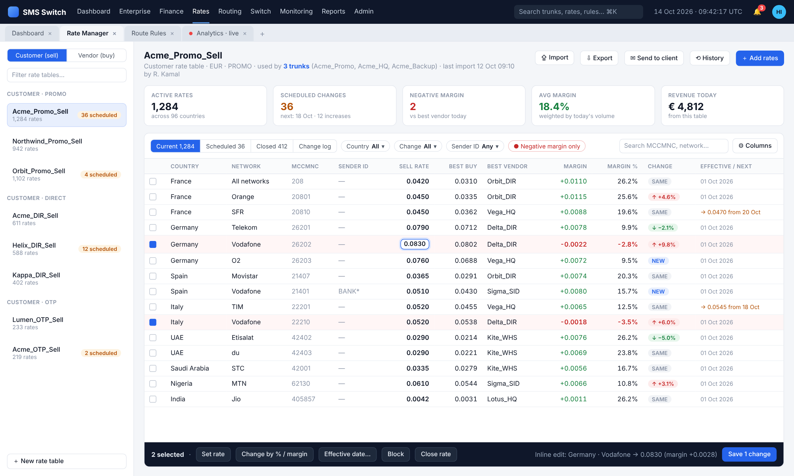
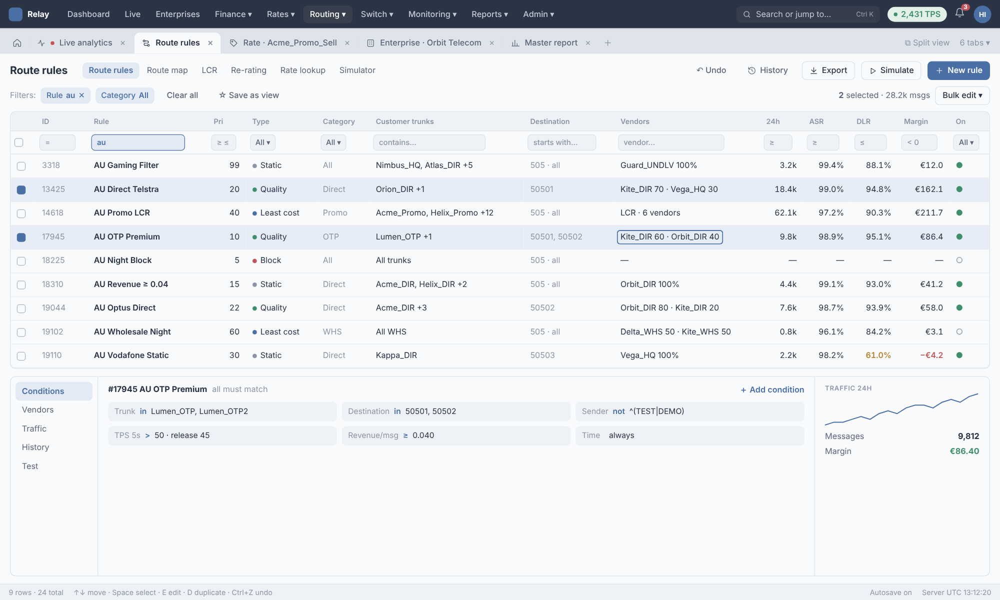
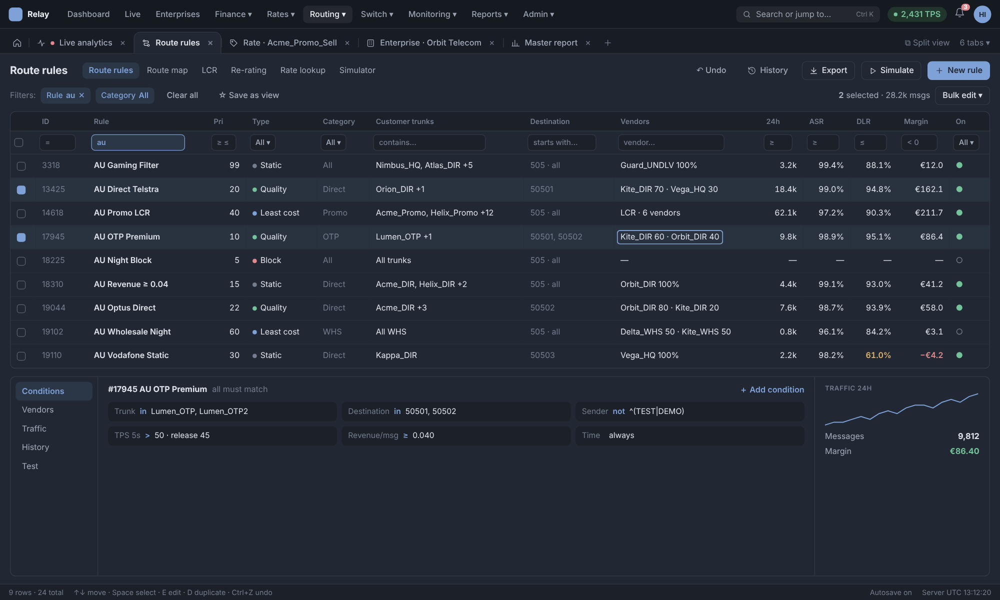

# SMS Aggregation Platform — Product Description

Exported from the Claude Docs product description (rev 65), Oct 16, 2026. The living doc is the master copy; re-export after changes.

## 1. Overview

The platform is a carrier-grade A2P/P2P SMS switch and business-support system for wholesale aggregators: it accepts traffic from customers over SMPP or HTTP, routes each message to the best vendor by rule, price and quality, and rates, bills and reports every attempt. This spec describes the reference platform (version 1.8.4) screen by screen so a team can rebuild it to parity, then improve on it.

**Who uses it**

- NOC engineers: trunks, binds, routing, translation, HLR, traces, troubleshooting.
- Rates / pricing team: rate tables, vendor rate imports, LCR, rate notifications.
- Finance: transactions, invoices, SOA, balances, vendor invoices, disputes.
- Account managers: enterprise records, contacts, reports, traffic alerts.
- Admins: business companies (tenants/brands), users, access groups, audit.
- Customers (optional): a separate customer portal with its own logins.

**Core objects and how they relate**

| Object | What it is | Key links |
| --- | --- | --- |
| Business Company | The selling entity/brand (multi-company tenancy) | Owns enterprises, email templates, invoice/SOA formats, SMTP accounts |
| Enterprise | A partner company; Customer, Vendor or Reciprocal (both) | Has customer trunks, vendor trunks, billing, docs, contacts |
| Customer Trunk | An inbound account (SMPP system\_id or HTTP user) | Rate tables, translation group, HLR group, TPS, category |
| Vendor Trunk | An outbound connection to a supplier | Vendor rate table, bind parameters, TPS/window, allowed codings |
| Product Category | Traffic class label (DIRECT, HQ, SIM, SS7, WHS, PROMO, OTP…) | Tags trunks, rate tables and route rules |
| Rate Table | Price list per MCCMNC/dial code/sender ID with validity dates | Attached to customer trunks; vendor rates live on vendor trunks |
| Route Rule | Match conditions → route table (vendors, hunt policy, margin) | Grouped in Route Rule Groups; chained via Next Group |
| Translation Rule | Ingress/egress rewrite or block of sender, receiver, content, TON/NPI, DLR | Grouped in Translation Rule Groups, attached to trunks |
| HLR Rule | Number-lookup provider selection by DNID pattern | Grouped in HLR Rule Groups, attached to customer trunks |
| EDR | Event Data Record: one row per message attempt with both legs | Feeds reports, billing, re-rating, disputes, repush |

**Global conventions (apply to every list screen)**

- Toolbar buttons at the top right act on the selected row (radio select). Common set: Add, Edit, Clone, View, Delete, Export, Import, Delete History (view deleted records), History (change log), Clear (reset all filters), Refresh.
- Every grid has a page-size selector (10, 25, 50, 100, 500, 1,000, 2,000, 4,000), a per-column search box under each header, dropdown filters on enum columns (with Select All), column sorting, Previous / page numbers / Next pagination, and a "Showing x to y of z entries" footer.
- Delete always opens a "Delete Record" confirmation modal (Yes / No). Records referenced elsewhere open a "Confirm and Proceed" modal that forces reassignment first (e.g. Reassign to Auto Upload Rule).
- Add and Edit open full-page forms at /module/add and /module/edit/{id} with Save and Cancel at the top right; required fields carry a red asterisk.
- Every record stores Updated By and Updated Time; many store Created By / Created Time.
- Multi-select pickers show a searchable checkbox list with "Selected n of N", Check All and Uncheck All.
- Buttons appear or disappear by the user's GUI Access Group; unauthorised URLs return 401.
- All times are UTC; the header clock shows server time.

## 2. SMPP foundations the platform must implement

The switch acts as an SMSC (server) toward customers and as an ESME (client) toward vendors, so it must implement SMPP v3.4 on both sides, with v5 TLVs where vendors use them ([smpp.org](https://smpp.org/), [v3.4 spec](https://smpp.org/SMPP_v3_4_Issue1_2.pdf)).

**Sessions and binds**

- Bind modes: Transmitter (TX), Receiver (RX), Transceiver (TR/TRX); responses and receipts return on the session and IP that sent the request (§13.1). Customer trunks also offer AUTO (accept whatever the client binds); vendor trunks choose TX, RX or TR.
- bind\_\* carries system\_id (Username), password, system\_type, interface\_version, addr\_ton, addr\_npi, address\_range — the last three are the vendor trunk's Bind Parameters (AddrTON, AddrNPI, AddrRange).
- enquire\_link keep-alive with a configurable response timeout (EnquireLinkRespTimeOutSec); unbind/unbind\_resp on shutdown; generic\_nack for malformed PDUs.
- Max Connections (1–10) limits concurrent binds per trunk; customer trunks whitelist the client Host Name (IP).
- TLS options on both sides: Non Secure, SSLv2, SSLv3, SSLv23, TLSv1, with an uploaded certificate (SSL File). A rebuild should add TLS 1.2/1.3.

**Message PDUs**

| PDU | Direction in the switch | Used for |
| --- | --- | --- |
| submit\_sm / submit\_sm\_resp | Customer → switch; switch → vendor | MT message; resp returns message\_id (customer side) or vendor message\_id (MsgID Type: Default, Decimal, Hexadecimal) |
| deliver\_sm / deliver\_sm\_resp | Vendor → switch; switch → customer | Delivery receipts (esm\_class bit 2) and MO messages |
| data\_sm | Either | Alternative transport, also carries receipts |
| query\_sm, replace\_sm, cancel\_sm | Customer → switch | Optional message management |
| enquire\_link, unbind, generic\_nack | Both | Session control |

**Addressing (TON / NPI)** — used in Route Simulator, translation rules and vendor allowed-lists:

| TON | Meaning | NPI | Meaning |
| --- | --- | --- | --- |
| 0 | Unknown | 0 | Unknown |
| 1 | International | 1 | ISDN / E.164 |
| 2 | National | 3 | Data (X.121) |
| 3 | Network specific | 4 | Telex (F.69) |
| 4 | Subscriber number | 6 | Land mobile (E.212) |
| 5 | Alphanumeric | 8 | National |
| 6 | Abbreviated | 9 | Private |
|  |  | 10 | ERMES |
|  |  | 14 | Internet (IP) |
|  |  | 18 | WAP client ID |

**data\_coding values offered** — 0 GSM 7-bit default (SMSC default), 1 IA5/ASCII, 2 and 4 Octet 8-bit, 3 Latin-1, 5 JIS, 6 Cyrillic, 7 Latin/Hebrew, 8 UCS2, 13 Extended Kanji, 14 KS C 5601. Customer trunks pick a Default Coding (GSM 7-bit(0) or Latin1 8-bit(3)); vendor trunks tick AllowedDataCodingList. Multipart (UDH concatenation) is controlled by Support Multipart and Max Msg Len, and rules can Deny Multipart.

**Delivery receipts** ([smpp.org DLR page](https://smpp.org/smpp-delivery-receipt.html))

- Requested via registered\_delivery (translation rules can force 0 or 1).
- Receipt text: `id:<msgid> sub:001 dlvrd:001 submit date:YYMMDDhhmm done date:YYMMDDhhmm stat:DELIVRD err:000 text:`; TLVs receipted\_message\_id, message\_state, network\_error\_code.
- stat values handled: DELIVRD, ACCEPTD, EXPIRED, DELETED, UNDELIV, UNKNOWN, REJECTD, plus intermediate ENROUTE, SENT, ACKED, BUFFRED.
- The switch maps the vendor message\_id back to the customer message\_id, rewrites the receipt, and pushes it on the customer's RX/TRX bind (or DLR Push URL for HTTP).
- DLR Timeout + DLR Timeout Stat: if no receipt arrives in time, the switch generates one with the chosen stat.
- Re-Route on DLR: vendor receipts with EXPIRED, DELETED, UNDELIV, UNKNOWN or REJECTD can trigger a retry on the next route level.

**command\_status error codes surfaced as Cause Codes** (EDR Search filter): -1 Unknown, 1 Invalid message length, 2 Invalid command length, 3 Invalid command ID, 4 Incorrect bind status, 5 Already bound, 6 Invalid priority flag, 7 Invalid registered delivery flag, 8 System error, 10 Invalid source address, 11 Invalid destination address, 13 Bind failed, 14 Invalid password, 15 Invalid system ID, 17 Cancel failed, 19 Replace failed, 20 Message queue full, 21 Invalid service type, 51 Invalid number of destinations, 52 Invalid distribution list, 64 Invalid destination flag, 66 Submit-with-replace not allowed, 67 Invalid esm\_class, 68 Cannot submit to distribution list, 69 Submit failed, 72–83 invalid TON/NPI and system\_type, 84 Invalid replace\_if\_present, 85 Invalid number of messages, 88 Throttling error, 97 Invalid scheduled delivery time, 98 Invalid validity period, 99 Invalid predefined message ID ([full list](https://smpp.org/smpp-error-codes.html)).

**Flow control** — TPS cap per trunk (customer submits above TPS get throttled, 0x58), Customer Overflow Buffer (messages queued instead of rejected), VendorWindowSize (outstanding unacknowledged submits), VendorOverflowBufferSize, SubmitInterval and Submit Timeout, plus a Business Company TPS Limit.

## 3. Navigation and global UI

The UI is a single top-bar web app: a header row, a horizontal menu of eight entries, and a content area with a page title, breadcrumb (e.g. Route / Route Rule / Add) and a right-aligned action toolbar.

**Header**

- Logo + product name (link to vendor site).
- Live server clock, format MM/DD/YYYY, HH:MM:SS UTC.
- Full-screen toggle icon.
- User avatar (initials). Menu: user name, role and company (e.g. Admin – company), Version (read-only), Edit Profile (/users/{id}/edit), Sign Out (/logout).
- Layout toggle (expand/collapse) button at the far right of the menu bar.
- Footer: copyright line.

**Menu tree (every item and its route)**

| Menu | Item | Route |
| --- | --- | --- |
| Dashboard | — | /dashboard |
| Enterprise | — (tabs: General Info, Docs, Billing, Vendor Trunk, Customer Trunk) | /enterprise |
| Finance | Transaction | /transaction/0 |
|  | Charges Calculator | /chargescalc |
|  | Invoice | /invoices |
|  | Currency | /currency |
|  | Currency Exchange | /currencyconversion |
|  | Enterprise Balance | /enterprisebalance |
|  | Billing Cycle | /billingcycle |
|  | Vendor Invoice | /vendorinvoice |
|  | SOA | /soa |
|  | SOA Report | /soareport |
| Product | Product Category | /productcategory |
|  | Country | /country |
|  | Master Table | /mastercode |
|  | MCCMNC Unique Codes | /mccmnc |
|  | MO Reference Book | /moreferencebook |
|  | Rate › IMAP Mail Account | /smtpmailaccount |
|  | Rate › File Template | /filetemplate |
|  | Rate › Auto Upload Rules | /autouploadrules |
|  | Rate › Auto Upload Failed Report | /autouploadfailed |
|  | Rate › Auto Upload Report | /autouploadreport |
|  | Rate › Rate Table | /ratetable |
|  | Route › Route Rule Group | /routerulegroup |
|  | Route › Route Rule | /routerule |
|  | Route › LCR | /lcr |
|  | Route › Re-Rating | /reprocessing |
|  | Route › Rate Lookup | /ratelookup |
| Switch | Translation Rule | /digitrule |
|  | Translation Rule Group | /digitrulegroup |
|  | HLR › HLR Provider | /hlrprovider |
|  | HLR › HLR Rule | /hlrrule |
|  | HLR › HLR Rule Group | /hlrrulegroup |
|  | Notification | /notification |
|  | Email Logs | /emaillogs |
|  | Number List | /numberlist |
|  | QBR Stats | /qbrstats |
|  | Firewall | /firewall/banip |
|  | Traffic Alert | /trafficalert |
|  | SMS To Voice | /sms-to-voice |
|  | Broadcast | /broadcast |
| Observation Deck | Signaling Deck | /signalingdeck |
|  | EDR Search | /edrdeck |
|  | EDR Template | /edrdownloadtemplate |
|  | EDR Download | /edrdownload |
|  | Route Simulator | /rouetsimulator |
|  | Network Status | /providerstatus |
|  | PCAP Trace | /networktrace |
|  | Failed EDR Search | /failededr |
|  | Failed EDR Download | /failededrdownload |
|  | Network Diagnosis | /pingtraceroute |
|  | Repush Request | /repush |
| Report | Master Report | /report/0 |
|  | Customize | /report/1 |
|  | Enterprise | /report/2 |
|  | Master Grouping | /report/10 |
|  | Usage Enterprise | /report/11 |
|  | Negative Margin Report | /report/12 |
|  | Analytics Report | /analytics |
|  | Bilateral Report | /bilateral |
|  | Schedule Report | /schedulereport |
|  | Daily Traffic Alert | /dailyreport |
| Admin | Business Company | /businesscompany |
|  | Departments | /departments |
|  | Users | /users |
|  | Logged In Users | /loggedin-users |
|  | GUI Access Group | /guiaccessgroup |
|  | Audit Trail | /audit\_trial |
|  | Email Template | /emailtemplate |
|  | Customer Portal | /customerusers |
|  | Report Template | /reporttemplate |

## 4. Dashboard (/dashboard)

The dashboard is a live NOC view of today's traffic, money and server health, refreshed on demand for a chosen look-back window. In the new platform it becomes fully live and animated (§13.3).

**Top bar controls**

- Server health pills: Cache Usage %, CPU Usage %, Memory Usage % (colour-coded).
- Time window dropdown: Last 2 / 5 / 15 / 30 Minutes, Last Hour, Last 4 / 12 / 24 Hours (scopes the four grids below).
- Refresh button.

**KPI tiles (today, server day)**

| Tile | Definition |
| --- | --- |
| Today's Attempts | Every submit received from customers |
| Today's Succeeded | Attempts accepted by a vendor (submit\_sm\_resp OK) |
| Today's Delivered | Attempts with a DELIVRD receipt |
| Online Customers | Customer trunks with a live bind |
| Online Vendors | Vendor trunks with a live bind |
| Today's Revenue | Sum of customer charges (system currency) |
| Today's Margin | Revenue − Cost |
| Today's Avg ASR | Succeeded ÷ Attempts × 100 |
| Today's Avg DLR | Delivered ÷ Succeeded × 100 |
| Cost | Sum of vendor charges |

**Four traffic grids** — Customer Enterprise, Vendor Enterprise, Customer Trunk, Vendor Trunk. Columns: Enterprise or Trunk (ID), ATMPT, SUCC, SUB (submitted), ASR, DLR, MRGN. Each column sorts; the first column is pinned; values are colour-coded (green good, amber mid, red low or negative margin); the grid scrolls inside its card.

**Enterprise selectors** — two searchable dropdowns (Customer Enterprise, Vendor Enterprise; placeholder "SELECT ENTERPRISE") to focus the page on one partner.

**Top-ten charts** — each card has a metric switch and a chart:

- Top Ten Customer Enterprise: Attempts, Successful, ASR, DLR, Revenue, Margin.
- Top Ten Vendor Enterprise: Attempts, Successful, ASR, DLR, Cost, Margin.
- Top Ten Destination: Attempts, Successful, ASR, DLR, Revenue, Margin.
- Top Ten Sender ID Attempt: attempts per sender ID.

## 5. Enterprise and trunks (/enterprise)

One Enterprise screen holds a partner's whole account. An enterprise selector ("Name – Alias (ID)", searchable) sits at the top right, next to five tabs.

### 5.1 General Info tab

Buttons: Add, Edit, Delete, Export. A read-only view in three panels; the Add/Edit form (/enterprise/add, /enterprise/edit/{id}) has the same fields.

| Panel | Fields |
| --- | --- |
| General Information | Name\*, Alias\*, Type (Customer / Vendor / Reciprocal), Category (Tier 1 / Tier 2 / Tier 3), Business Company\*, Status (Active / Inactive), Bind Alert (checkbox: email on bind down), Credit Alert (checkbox), Credit Alert Percentage\* — Notice %, Warning %, Critical % (defaults 50/70/90) |
| Address Information | Address Line 1\*, Address Line 2, City, State, Country (list of 244), ZIP/PIN Code, Website, Fax, Registration Number, VAT Number |
| Contact Information | Four contact blocks — Commercial, Technical, Rates, Finance — each with Name, Phone, Email\* (multi-address textarea) |
| Account Manager Information\* | User (account manager, from Users) |

### 5.2 Docs tab

Contract and KYC storage. Buttons: Add (upload file + name), Delete. Grid: Info ID, Name, Download File (button), Created By, Created Time.

### 5.3 Billing tab (/billing/{id})

- Customer Billing Information: Customer Balance (currency + amount), Currency, Billing Cycle (e.g. Monthly – Net 7), Timezone, Billing Type (Prepaid / Postpaid), Credit Limit, Opening Balance, Auto Invoicing (Enabled/Disabled), Description, Updated By/Time.
- Vendor Billing Information: Vendor Balance, Currency, Billing Cycle, Timezone, Opening Balance.
- Beneficiary Information (Edit button): Beneficiary Name, Address, Bank, Bank Address, Currency, Account Number, IBAN, Swift Code, Wallet Address (crypto).

### 5.4 Customer Trunk tab

Toolbar: Add, Edit, Clone, View, Send Rate (email the rate sheet), Send Tech Info (email connection details), Delete, Delete History, Clear. Grid: Trunk ID, Trunk Name, Username, Category, Translation Rule Group, Protocol, TPS, Status, Updated By.

Form (/customertrunk/add|edit|view/{id}):

| Section | Field | Values / SMPP meaning |
| --- | --- | --- |
| Trunk information | Trunk Name\* | Free text (convention Partner\_Category) |
|  | Protocol | SMPP or HTTP |
|  | Translation Rule Group | Ingress rewrite group (§6.4) |
|  | Billing Type | Attempt, Submit, Reported, Delivery — the event that makes a message billable |
|  | Status | Active / Inactive |
|  | Bind Type | TX, RX, TR, AUTO |
|  | HLR Rule Group | Lookup policy (§6.5) |
|  | Consider HLR Rate | Add HLR cost to the customer charge |
|  | Service Type Routing | Use SMPP service\_type as a routing key |
|  | Part Wise Routing | Route each multipart segment independently |
| Connection | Host Name\* | Allowed client IP(s) |
|  | Username\* / Password\* | SMPP system\_id / password |
|  | Max Connections | 1–10 binds |
|  | SystemType | Expected system\_type |
|  | Port\* | Listener port |
|  | SSLType / SSL File | Non Secure, SSLv2, SSLv3, SSLv23, TLSv1 + certificate |
|  | DLR Push URL / MO Push URL | HTTP protocol only: callback URLs |
|  | Delayed Submit | Off / On — respond submit\_sm\_resp only after vendor accepts |
|  | Send Bind | Notify the customer of bind events |
| Limitation | TPS\* | Max submits per second |
|  | Customer Overflow Buffer | Messages queued beyond TPS (e.g. 10,000) |
|  | Loop Detection | Active / Inactive — block messages that return to the switch |
|  | Default Coding | GSM 7 bit (0) or Latin1 8 bit (3), applied when data\_coding = 0 |
| Rate Table List | Category | Product Category radio list |
|  | Rate Table | One or more rate tables (multi-select); first match wins |
| Express Vendor Selection | Vendor Trunk + Margin | Bypass routing and pin this trunk to one vendor at a fixed margin |

### 5.5 Vendor Trunk tab

Toolbar: Add, View, Edit, Clone, Rate (open vendor rates), Import Rate, Export Rate, Import History, Delete, Delete History, Rate History, Clear. Grid columns match the customer trunk grid.

Form (/vendortrunk/add|edit/{id}):

| Section | Field | Values / SMPP meaning |
| --- | --- | --- |
| General | Trunk Name\*, Protocol\* (SMPP/HTTP), Translation Rule Group (egress), Category\*, Status\*, Billing Type (Attempt/Submit/Reported/Delivery), Bind Type (TX/RX/TR) |  |
| Connection (SMPP) | Username\*, Password\*, SSLType, SSL File, Host Name\*, Max Connections (1–10), SystemType, ServiceType, SubmitInterval, EnquireLinkRespTimeOutSec, SMPP Port\*, Submit Timeout, Source Host (local bind IP), MsgID Type (Default / Decimal / Hexadecimal) | MsgID Type normalises vendor message\_id so receipts match |
| Connection (HTTP) | URL\*, Receiver Port, Success Regex, MessageID Regex, Callback URL, Callback Interval, DLR Status Regex, DLR MID Regex, DLR Success Stats, DLR Fail Stats, Extra Headers, Post Data, Callback Extra Headers, Callback Post Data | Generic HTTP-API adapter: request template + regex parsing of response and callbacks |
| Limitation | TPS\*, VendorOverflowBufferSize, VendorWindowSize, AllowedDataCodingList (0,1,3,5,6,7,8,13,14), Re-Route on (EXPIRED, DELETED, UNDELIV, UNKNOWN, REJECTD), Allowed src TON, Allowed dst TON, Allowed src NPI, Allowed dst NPI, Max Msg Len, Support Multipart (Yes/No), DLR Timeout, DLR Timeout Stat (DELIVRD/EXPIRED/UNDELIV/REJECTD/UNKNOWN) | Vendor capability filter; routing skips a vendor that cannot accept the message |
| Bind Parameters | AddrTON, AddrNPI, AddrRange | bind\_\* addr\_ton / addr\_npi / address\_range |

**Product categories in use** (radio list on trunks and rate tables): DIRECT, HQ, SS7, SIM, WHS, PROMO, H-CR, LOCAL, OTP, SPECIAL, SPCL, CS, ATX, Enterprise, WA – WhatsApp, Rerating, ServiceDLR, Test and testing categories. A rebuild should keep the list user-defined (§6.1).

## 6. Product, rates and routing

Routing is decided per message in this order (inferred from where each setting lives; the UI does not state it): ingress translation → HLR lookup (optional) → customer rate lookup → route rule match → vendor selection by hunt policy and margin → egress translation → submit, with DLR-driven re-route on failure.

```
Message path through the switch (9 stages) and the receipt return

 1. Customer bind / session (customer trunk auth, IP check, TPS)
 2. submit_sm received, submit_sm_resp on the same session (§13.1)
 3. Ingress translation (sender / receiver conversion)
 4. HLR / MNP lookup (optional, §13.24)
 5. Customer rating (customer rate table → price)
 6. Route rule match (static / dynamic / QBR / block, TPS & revenue conditions)
 7. Vendor selection (hunt policy, priority, margin, limits)
 8. Egress translation (vendor side)
 9. submit_sm to vendor trunk
 ↩ Receipt return: vendor deliver_sm (DLR) → map to original message
   → EDR update / billing → re-route on failure → deliver_sm to customer
   on the originating session and IP (§13.1)
```

Each stage maps to one screen family below; the receipt path on the right closes the loop and is where billing and re-routing happen.

### 6.1 Product reference data

| Screen | Toolbar | Grid columns | Add/Edit fields |
| --- | --- | --- | --- |
| Product Category | Add, Edit, View, Delete, Delete History, Clear | Info ID, Category Name, Updated By | Category Name |
| Country | Add, Edit, View, Export, Clear, Search | Info ID, Name, ISO Code, Dial Code, Updated By | Name, ISO, Dial Code |
| Master Table (dial-code profiles) | Add, View, Edit, Export, Import, Delete, Delete History, Clear, Search; modal Master Data Import | Profile, Updated By | Profile\* (All), Dial Codes\* — maps dial-code prefixes to MCCMNC |
| MCCMNC Unique Codes | Add, Edit, View, Import, Export, Delete, Clear, Search; modal MCCMNC Unique Codes Import | MCC, MNC, Original MNC, MCCMNC, ISO, Country, Country Code, Code Network | Same fields |
| MO Reference Book (two-way / MO billing) | Add, Edit, View, Import, Delete, Clear, Search; modal MO Reference Book Import | Info ID, Customer Trunk, Number, Keyword, Rate, Vendor Rate, MCCMNC, Destination, Setup Charge, Fix Charge, Created Time, Created By | Same fields |

The MCCMNC list (about 1,965 entries) is the routing and rating key. Each country also has an "All Networks" code (MCC only) used as a fallback.

### 6.2 Rate tables and rate automation

**Rate Table** (/ratetable). Toolbar: Add, Edit, Clone, View, Delete, Rate (open the rate lines), Import Rate, Export Rate (Excel XLSX or CSV), Send Rate (emails the sheet; modal Customer Send Rate Information with File Type, Send Email), Import History, Rate History (modal Rate History Information), Delete History, Clear.

- Header grid: Rate Table ID, Name, Category, Currency, Customer Trunk, Description, Updated By.
- Add form: Category Name\*, Rate Table Name\*, Currency\* (EUR/INR/USD from Currency), Description, Copy Rate From Vendor Rate (Yes → pick Vendor Trunk + Margin %) to build a sell table from a buy table.
- Rate lines grid: Rate ID, MCCMNC, Dial Code, Sender ID, Country, Network, Rate, Sys Rate (converted to base currency), Currency, From Date, To Date, IsBlock, Change Type (carried from the vendor sheet, e.g. New / Increase / Decrease), Rate Note, Updated By, Update Time.
- Rule (inferred, confirm with vendor docs): the line valid at submit time, most specific match first (Sender ID + MCCMNC → MCCMNC → Dial Code → country All Networks). IsBlock rejects traffic at that price point.

**Vendor rate automation by email**

1. IMAP Mail Account — inbox the platform polls. Grid: Info ID, Name, Email, IMAP Server, IMAP Port, Auth Type (Plain Text / TLS / SSL), Account User ID, Status, Updated By/Time. Form adds Account Password and OAuth2 fields: Client ID, Client Secret, Redirect URIs\*, Access Token\*, Refresh Token\*, Token Expires Time\*.
2. File Template — how to parse a vendor's rate sheet. Fields: Name\*, Sheet Number (xls/xlsx)*, Skip Row*, Date Format\* (9 formats e.g. YYYY-MM-DD, DD/MM/YYYY), Timezone\*, From Date Cell Number, Import Type\* (REPLACE = full price list / UPDATE = partial), and the column positions: MCCMNC Code or MCC + MNC (one required), Sender ID, Dial Code, Rate\*, Currency, Country, Network, From Date, To Date, Rate Note, Change Type.
3. Auto Upload Rule — ties a mailbox and template to a vendor trunk. Fields: Rule Name\*, Queue Type\* (Immediate / Queue when busy / Always Queue), Enterprise, Vendor Trunk\*, IMAP Mail Account\*, File Template\*, Notification Email, Enterprise Contact Email (Commercial/Technical/Rates/Finance), File Name (Pattern), Subject (Match), From Email (Match)*, To Email (Match)*, Email Body (Match), Status\*. Toolbar: Add, Edit, Clone, View, Clear, Delete.
4. Auto Upload Report — one row per processed email: Info ID, Rule, From/To Email, Subject, Trunk Type, Vendor Trunk, Status (Pending, Success, InProgress, Failed, Timeout, Expired, Rejected, Queue), Email Receive/Read Time, Comments, File Status (Valid/Invalid), Rejected By/Time. Buttons: Refresh, Clear, Status (approve/reject), Download Email File; modal Auto Upload Rate Information lists parsed lines (Rate Action, MCCMNC, Dial Code, Rate, Currency, Country, Network, From/To Date, Rate Note, Error).
5. Auto Upload Failed Report — emails that matched no rule or failed parsing: IMAP Account, Rule, From/To, Subject, File Name, Email ID, Error, receive/read/update times; same rate-detail modal.

### 6.3 Route rules, LCR, re-rating and rate lookup

**Route Rule Group** — a named container (field: Route Rule Group\*). Grid: Info ID, Route Table Group, Updated By/Time. Groups let one rule hand off to another via Next Route Rule Group.

**Route Rule** (/routerule). Toolbar: Add, Edit, Clone, View, Delete, Clear, Refresh, History (modals History Log, History Detail), Bulk Operation. Grid: Info ID, Name, Product Category, Customer, MCCMNC, Priority, Route Type (Block / Static / Dynamic / QBR), Vendor Category, Vendor, Route Rule Group, Next Route Rule Group, Route Table, Start Time, Stop Time, Status. Pop-ups: MCCMNC – Full List, Customer Trunk – Full List, Route Table Details, Vendor Rates.

Add form — General Information (the match side):

- RouteRule Name\*, RouteRule Priority\* (1–100; evaluation order by priority), Start Time\*, Stop Time\* (default now → +10 years; enables scheduled routing).
- Product Category Type\* and Customer Trunk Type\* and MCCMNC Type\*: All / Inclusive / Exclusive, each with a multi-select list (Country filter for MCCMNC).
- SenderID Pattern, ReceiverID Pattern, Contents Pattern (regex), each with Match / Not Match.
- Sender ID List and Receiver ID List (from Number List) with Match / Not Match.
- Continue Routing\*: YES (keep evaluating), STOP, NEXT (jump to Next Route Rule Group). Status\*: Active / Inactive.

Add form — Route Information (the action side):

- Route Table Type\*: Block, Static (fixed vendor list), Dynamic (cheapest-first LCR from vendor rates), QBR (quality-based: ASR/DLR/delay scores).
- Hunt Policy\*: Top Down, Round Robin, Percentage (with Consider CustomerTrunk In Percentage). Enable Backup Routes.
- Product Category Type + list and Vendor Trunk Type (Inclusive/Exclusive) + list to scope dynamic routing; Product Category Load % and Vendor Trunk Load % for percentage splits.
- Max Route Level\* (1–10): number of fallback levels; each level row = Vendor Trunk + value (percentage or order).
- Margin\* (minimum margin a vendor must leave; vendors below it are skipped) and Predictive Route Costing (shows vendor cost and margin per level while editing).
- QBR Condition and QBR Formula (expression over ASR, DLR, ADD).
- Advance Settings: HLR Ported (Yes/No), HLR Provider Error Codes, DNIS Score, Number Check, Condition expression (with Supported Variables / Operators help), Deny Multipart, Threshold\* + Interval (Day/Hour/Minute) for volume caps.

Bulk Operation modal: Customer Trunk Type (All/Inclusive/Exclusive), Operation Type (Update / Replace / Delete), Customer Trunk list, Vendor Trunk Type (Replace), Vendor Trunk and Replace Vendor Trunk — swaps one vendor for another across all rules. A status modal shows progress.

**LCR** — asynchronous least-cost report. Button LCR Request (choose scope), View, Refresh. Grid: LCR No, File, Status, Request Start/End Time, Error, Requested By.

**Re-Rating** — recompute charges on past EDRs after a rate correction. Buttons: Request, View, Edit, Refresh, Clear. Grid: Request id, Enterprise Type (Customer/Vendor), Reprocess Type (Manual/Auto), Description, Sender ID, Start Date, End Date, Request Status (Pending Approval / Approved / Declined — maker-checker), Reprocess Status (In Queue / Inprocess / Completed / Failed), Updated By.

**Rate Lookup** — compare prices before routing. Inputs: Product Category\*, Customer Trunk\*, Country\*, MCCMNC\* (multi-selects), Currency. Button Search returns customer rate vs vendor rates and margin per destination.

**QBR Stats** (Switch menu) — the quality feed for QBR routing, refreshed every 5 minutes. Selector QBR Stats For (Customer/Vendor), Customer Trunk, Vendor Trunk; grid MCCMNC, ASR, DLR, ADD (average delivery delay, s), Updated At. Button Add Vendor Stat (modal: Vendor Trunk\*, MCCMNC\*, ASR, DLR, ADD) seeds or overrides scores.

### 6.4 Translation rules (Switch › Translation Rule / Group)

In the new platform the rule → group → trunk chain below is replaced by single-step rules (§13.2). Translation rules rewrite, allow or block a message on the way in (Ingress, on the customer trunk) or on the way out (Egress, on the vendor trunk).

**Translation Rule** grid: ID, Name, Type (Ingress/Egress), Action (Block/Allow), Continues (No/Yes), Sender ID, DNID, MCCMNC, Message Text, Sender ID Conversion Type, Sender ID, Updated By. Toolbar: Add, Edit, Clone, View, Delete, Delete History, Clear, Search.

Form (/digitrule/add):

| Part | Fields |
| --- | --- |
| Header | Name\*, Type (Ingress / Egress), Is Continue (Yes = apply further rules / No) |
| Match conditions, each with Match / Not Match | Sender ID (pattern), Receiver ID, MCCMNC, Message Body Text, Sender ID List, Receiver ID List (from Number List) |
| Sender ID conversion | Type: Left Strip, Right Strip, Prepend, Append, Translation, Random Number, Sender ID Template; value or list (Number List of type Random / Sender ID Template) |
| Receiver ID conversion | Type: Left Strip, Right Strip, Prepend, Append, Translation; value |
| SMPP field overrides | Sender TON, Sender NPI, Destination TON, Destination NPI, Billing Type (Attempt/Submit/Reported/Delivery), Registered Delivery (0/1) |
| DLR conversion | DLR Status & Error Code Convert (map vendor stat/err to the customer's) |
| Content rewrite | Action (Allow / Block), Regex Pattern, Regex Index (1–5), Message Text, MSG Template |
| Length guards | Sender ID Min/Max Length\*, Receiver ID Min/Max Length\* |

**Translation Rule Group**: Name\*, Type, Translation Rule Ingress\* (ordered list), Translation Rule Egress\*. Grid: ID, Name, Type, Updated By. Groups attach to trunks.

**Number List** (Switch menu) feeds these rules and route rules. Grid: Info ID, Name, Type (Random / Tag / Sender ID Template), Updated By/Time. Toolbar: Add, Edit, View, Delete, Import List, List (view entries; modal Number List Information), Export, Clear.

### 6.5 HLR / number lookup

- **HLR Provider**: Provider Name\*, UserName, Password, URL\* (request template), Extra Headers, Data (POST body), Currency, Enable Caching (0–7 days), and response-mapping captions: MCC\*, MNC\*, MCCMNC\*, Old MCC, Old MNC, Old MCCMNC, Ported, Error Code, Error String, Success Codes, Number Check, DNID Score. Toolbar adds Rate, Import Rate, Export Rate (per-lookup prices; modal HLR Rate Information).
- **HLR Rule**: Rule Name\*, Provider Name\* (live HLR, MNP/NPQ, number-check providers), DNID Pattern\* (which destination numbers go to that provider).
- **HLR Rule Group**: Rule Group Name\*, HLR Rule List\* (ordered). Attached on the customer trunk; results feed routing (true MCCMNC after porting, HLR Ported, error codes, DNIS score) and are logged in the EDR and the HLR report columns (cached, live, accomplished, ported, cost).

## 7. Finance and billing (Finance menu)

Finance turns rated EDRs into balances, invoices and statements, per enterprise and per side (customer and vendor), with multi-currency conversion to the business company's base currency.

| Screen | Toolbar / buttons | Grid columns and filters | Form fields |
| --- | --- | --- | --- |
| Transaction (/transaction/0) | Add, Export, Clear, Delete, History (modal Transaction History Information, filtered by Customer Enterprise), Search | Name, Payment Date, Transaction Time, Mode of Payment (Cash, By Cheque, Bank Transfer, Paypal, Credit Card, Debit Card, Wire Transfer, Crypto), Payment Type (Credit/Debit), Transaction Type (Receipt, Adjustment, Disputes, Credit Note, Bank Charges, Bill Payment, Reprocess), Amount, Invoice Number, Description, Updated By | Transaction Information: Enterprise Type (Customer/Vendor), Enterprise Name\*, Invoice Number, Mode of Payment\*, Transaction Type\*, Payment Type\* (Credit/Debit), Payment Date\*, Amount\*, Transaction Description. Transaction Conversion: Source Currency, Final Amount (base currency, calculated) |
| Charges Calculator | Go | — | Enterprise (Select All or one), Period From, Period To; returns usage charges for the period |
| Invoice (/invoices) | Send Invoice, Send SOA, Invoice Request, Generate Request, Refresh, Export, Clear, Mark (bulk status), Delete; per-row Regenerate; header checkbox for bulk select | Invoice No, PDF (icon download), Charge Details, Enterprise Name, Enterprise Type (Customer/Reciprocal), Invoice Type (Auto/Manual), Billing Type (Prepaid/Postpaid), Invoice Date, Usage Start Date, Usage End Date, Payment Due Date, Due Amount, Opening Balance, Usage Charges, Closing Balance, Email Status (UnSent/Sent), Status (Pending/Inprogress/Completed/Failed), Remarks, Action | Generate Request: enterprise + period, runs async |
| Currency | Add, Edit, Export, Clear | Currency ID, Currency, ISO, Symbol, Updated By | Currency, ISO, Symbol |
| Currency Exchange | Edit, Sync Rates (pull market rates), History (modal Currency Exchange History Information, search by ISO, currency, rate, time, user), Clear | Info ID, ISO, Currency, Rate, Updated Time, Updated By | Rate |
| Enterprise Balance | Send SOA, Refresh, Clear, CSV, Excel | Enterprise Name, Customer Balance, Vendor Balance, Net Balance (Customer − Vendor), Account Manager, Customer Credit, Billing Cycle, Currency | — |
| Billing Cycle | Add, Edit, Delete, Clear | Info ID, Name, Usage Days, Due Days, Billing Type (Custom/Weekly/Fortnightly/Monthly), Week Day (MON–SUN), Updated By/Time | Name\*, Billing Type\*, Week Day, Usage Days\*, Due Days\* (e.g. Monthly – Net 7) |
| Vendor Invoice | Add, Edit, Export, Import (modal Vendor Invoice), Delete, Clear | Info ID, Enterprise Name, Invoice Number, Charge Volume, Charge Amount, Invoice Date, Invoice Due Date, Invoice From/To Date, Dispute Amount (vendor invoice vs platform cost), Remarks, Timezone, Input From/To Date, Created By/Time | Enterprise\*, Invoice Number, Charge Volume, Charge Amount\*, Invoice Date\*, Invoice Due Date, Invoice From Date\*, Invoice To Date\*, Timezone, Remarks |
| SOA (statement of account) | Search, Send Email, Queue SOA Export, Check All, Uncheck All | — | Enterprise\* (multi), Invoice Type\* (All/Auto/Manual), From Date\*, To Date\*, Send SOA Email Template\* |
| SOA Report | Refresh, per-row Send Email (modal Send SOA Email Notification: Enterprise, Template) | ID, Enterprise, From Date, To Date, Invoice Type, File Type (Excel/PDF), Status (Pending/Inprogress/Success/Failed), Error, Download, Created Time, Action | — |

**Billing rules to implement**

- Billable event per trunk: Attempt, Submit, Reported or Delivery (customer and vendor sides independent), stored as Is Customer Billable / Is Vendor Billable in the EDR.
- Prepaid: balance is decremented in real time; traffic stops at zero (plus credit). Postpaid: Credit Limit with Notice/Warning/Critical alerts at the configured percentages.
- Auto Invoicing generates invoices at the end of each billing cycle in the enterprise's timezone, using the business company's invoice XLSX format and email template.
- Balances = Opening Balance + transactions (credits/debits) − usage charges; Net Balance nets customer against vendor for reciprocal partners.

## 8. Switch utilities (Switch menu)

Beyond translation, HLR, Number List and QBR Stats (§6), the Switch menu holds partner notifications, security and alerting tools.

| Screen | Toolbar | Grid / fields |
| --- | --- | --- |
| Notification | Send Rate, Send Tech Info, View Rate, Clear, Search; modal Customer Send Rate Information (File Type: Excel XLSX / CSV, Send Email) | Enterprise Name, Customer Trunk Name, Category, Protocol (SMPP/HTTP), Capacity, Status. Bulk-send rate sheets or connection details to selected trunks |
| Email Logs | Clear | Info ID, Enterprise, Customer Trunk, Vendor Trunk, Email Type (Send Rate, Send Tech Info, Invoice, Check SMTP Connection, Bind Down Alert, OTP, Forgot Password, Auto Upload Rate, Credit Alert, Balance Alert, Schedule Report Alert, Traffic Alert, Auto Upload Report – Rejected, Daily Report, Broadcast, Trouble Ticket, Send SOA), Status (Sent/Failed), Rate Date, File, Error, To Address, CC Address, Updated By/Time |
| Firewall | Tabs: Banned IP, Trusted IP, Filter. Add, Search | IP Address, Filter, Action. Blocks or whitelists IPs at the SMPP/HTTP listeners (brute-force protection) |
| Traffic Alert | Add, Edit, Clone, Delete, Clear | Grid: Info ID, Name, Customer Trunk, Vendor Trunk, Notification Email, Status. Form: Name\*, Sample Count (≥)*, Sample Interval (minutes)*, ASR Threshold (≤)*, DLR Threshold (≤)*, MRG Threshold (≤)*, Customer Trunk*, Vendor Trunk, Sender ID, MCCMNC, Average Delivery Delay (s ≥), Notification Email, Enterprise Contact Email, Email Template\*, Status\* |
| SMS To Voice | Add, Edit, Delete, Clear | SmsVoiceID, Sender ID, Receiver ID, Prefix, Repeat, Destination, Updated By, Action. Converts matching SMS (e.g. OTP to landlines) into a voice call |
| Broadcast | Send Email | Business Company\*, Business Company Contact\* (sender mailbox), Subject\*, Enterprise Contact Email\* (Commercial/Technical/Rates/Finance), Email Body\* (rich-text editor: styles, links, images, video, tables), Attachment. Mass email to all partners |

## 9. Observation Deck (monitoring and troubleshooting)

The Observation Deck is the NOC's troubleshooting toolkit: live bind status, per-message records, packet captures, route simulation and network tests.

### 9.1 EDR Search (/edrdeck)

Buttons: Trouble Ticket, Search.

- Filters: From Date, To Date, Final (only final attempt), Sender ID, DNID (destination), Customer Msg ID, Vendor Msg ID (comma-separated lists), EDR Template (saved column sets), Customer Enterprise, Customer Trunk, Customer MCCMNC, Vendor Enterprise, Vendor Trunk, Vendor MCCMNC (multi-selects), Cause Code (SMPP command\_status list, §2), Message Status (DELIVRD, ACCEPTD, EXPIRED, DELETED, UNDELIV, UNKNOWN, REJECTD, SENT, ACKED, BUFFRED, ENROUTE), HLR Provider Error Codes, Type (MO/MT).
- Result columns (the EDR schema): Start Time, Submit Time, SubmitResp Time, Delivery Time, UUID; customer leg — Enterprise ID, Trunk ID, IP, Port, Message ID, SRC/DST TON and NPI, Coding, SMS Type, SRC Addr, Dest Addr, Message Text, Routed Dest Addr, Rate, Currency, Sys Rate, MCCMNC, MCC, MNC, Billing Type, Translation Rule ID, Rate Table ID, Route Table ID, Product Category ID, Rate Destination, Submit Time, Delivery Time, Msg Status, Delivery Status, Protocol; vendor leg — the same set plus ExRate; then Attempt No, Delivery Error, Message Status, Delivery Status, Network Error, Error Code, Registered Delivery (V/C), UDH, Cost, CostSysRate, Is Customer Billable, Is Vendor Billable, Is Final Attempt, IsSubmitSuccess, Delivery Stamp, Error String, MSG Count, HLR Rule Group ID, HLR Provider ID, HLR Fetch Type, HLR Error Code, HLR Provider Error Code, HLR Error String, HLR Is Ported, HLR Is Accomplished, HLR Cost, IsBuffered, IsUpdated, Delivery Delay (s), Customer/Vendor Translation Group, Route Rule ID, Route Rule Group ID, DLR ReRoute, Campaign ID, Lead ID, Response Campaign/Lead ID, Repush Request ID, Meta Data.
- Trouble Ticket modal: Ticket Send To (Customer/Vendor), Vendor Trunk\*, Trouble Ticket Template\*, Email Subject\*, Attachment, Email Columns\* (pick EDR columns to include), Send Mail.
- EDR Repush modal: re-send selected EDRs to a chosen Vendor Trunk\* (Save / Proceed); creates a Repush Request.

### 9.2 Other Observation Deck screens

| Screen | Controls | Output |
| --- | --- | --- |
| Signaling Deck | Filter (IP address), Max Duration (s), Max File Size (bytes), Start | Captured SMPP trace files: Sr. No., File Name, File Size, Download, Update Time |
| EDR Template | Add, Edit, View, Clear, Search | Info ID, Name, Updated By/Time. Form: Name\*, Column Selection\* (any EDR column) |
| EDR Download | EDR Request, View, Refresh, Clear | EDR No, Status, File, File Type, Progress, Request Start/End Time, Error, Requested By (async CSV/XLSX export) |
| Route Simulator | Go | Inputs: Customer Trunk ID\*, Sender ID, Receiver ID\*, MCCMNC, Source TON\*, Source NPI\*, Dest TON\*, Dest NPI\*, Service Type Routing, Message Text, Test SMS, Data coding (0–8). Live counter: coding, SMS per message, message size (chars/bits). Shows the rule, route table and vendors that would be chosen; Test SMS sends a real message |
| Network Status | Tabs Customer / Vendor; Refresh, Clear, CSV, Excel; per-row Start / Stop | Enterprise ID, Customer/Vendor ID, Enterprise Name, Trunk Name, IP Address, Number of Connections, Status (online/offline). Start/Stop binds a vendor or kicks a customer session |
| PCAP Trace | Clear, Search | File Name, File Size, Download, Update Time (UTC) |
| Failed EDR Search | Search, Generate Request | Messages rejected before routing. From Date\*, To Date\*, Customer IP, Customer Msg ID, Error Code, Download File Type (csv/xlsx), Customer Enterprise, Customer Trunk |
| Failed EDR Download | Failed EDR Request, Refresh, Clear | Failed EDR No, Status, File, File Type, Progress, Start/End Time, Error, Requested By, Action |
| Network Diagnosis | Go | Tool: Ping, Trace Route, MTR, Telnet; Count, Destination\*, Source, Port. Runs from the switch host |
| Repush Request | Clear | Info ID, Total EDR Count, Created By, Created Time |

## 10. Reports (Report menu)

All traffic reports share one engine: pick filters and a time range, pick metric columns with Column Selection (27 metrics; Cancel / Apply), press Go.

**Shared metric columns**: Attempts, Successful, Billable (Customer), Billable (Vendor), Submitted, ASR %, DLR (Customer) = DLR(s), DLR (Vendor) = DLR(t), Margin, Revenue, Revenue (B = base currency), Avg Rate (Customer), Avg Rate (Vendor), Reported (C), Reported (V), Margin %, Cost (Avg), Cost, Cost (B), Delivery Delay (s), HLR Cached, HLR Live, HLR Total, HLR Accomplished, HLR Ported, HLR Cost, HLR Cost (B).

**Shared filters**: Timezone (31 zones, GMT−12 to +12), From Date\* / To Date\* with hour pickers (00–23), Type (MO/MT).

| Report | Extra controls |
| --- | --- |
| Master Report (/report/0) | Report By (None, Hourly, Daily, Weekly, Monthly, Custom) which switches the date inputs (Date, Year, Month, From/To); Enterprise Type (Customer/Vendor); Enterprise, Trunk, Rate Table, Route Table, MCCMNC, Account Manager (multi-selects) |
| Customize (/report/1) | Level 1\*, Level 2, Level 3 grouping, each from Date, Hour, Customer, Customer Trunk, Customer IP Address, Customer Destination, Vendor, Vendor Trunk, Vendor IP Address, Vendor Destination; filters Customer, Trunk, Destination, Vendor, Customer IP, Vendor IP |
| Enterprise (/report/2) | Enterprise Type, Enterprise, Trunk, MCCMNC, Account Manager |
| Master Grouping (/report/10) | Free multi-level grouping with checkboxes: Date, Hour, Customer, Customer Trunk, Customer IP, Customer Destination, Customer Country, Vendor, Vendor Trunk, Vendor IP, Vendor Destination, Vendor Country, Customer Account Manager |
| Usage Enterprise (/report/11) | Same filters as Enterprise; usage for billing reconciliation |
| Negative Margin Report (/report/12) | 13 columns: Date, Customer Name, Customer Destination, Customer Trunk, Vendor Name, Vendor Trunk, Product Category, Successful, ASR %, Margin, Margin %, HLR Cost, HLR Cost (B); filters Customer, Trunk, Destination, Vendor |
| Analytics Report (/analytics) | Live updates without reloading in the new platform (§13.4). Report By (Customer, Customer Trunk, Customer Country, Customer Network, Customer MCCMNC, Vendor, Vendor Trunk, Vendor Country, Vendor Network, Vendor MCCMNC, Customer Account Manager, Vendor Account Manager, Sender ID); Period (Minute, Hour, Day, Weekly, Monthly) with 1/5/15-minute buckets; Search, Export Top, Export Bottom. Columns: Date, Attempt, Successful, Submitted, Billable (C/V), ASR %, DLR(s), DLR(t), Margin, Revenue, Delivered, Reported, HLR, HLR Ported Count, Rate (C), Rate (V), Cost, Delivery Delay, HLR Cost; top/bottom panels with charts |
| Bilateral Report (/bilateral) | Enterprise; customer vs vendor traffic with one reciprocal partner |
| Schedule Report | Grid: Info ID, Name, Status. Form: Report Template\*, Description, Schedule Report Name\*, Status\*, Business Company\*, Notification Email\*, CRON Interval\* (Minute, Hourly, Daily, Weekly, Monthly), CRON Frequency\*, CRON Scheduler Expression\* (Minute, Hour, Day, Month, WeekDay), Email Body\* (rich text) |
| Daily Traffic Alert | Grid: Info ID, Name, Status. Form: Name\*, Status\*, Business Company, Enterprise Contact Email\* (contact type), Enterprise\*, Email Body\* — a daily traffic summary emailed to partners |

## 11. Admin

| Screen | Toolbar | Grid / form |
| --- | --- | --- |
| Business Company | Add, Edit, Clone, View, Delete, Clear | Grid: Info ID, Name, Description, Base Currency, TPS Limit, Updated By/Time. Form: Name\*, Description, Company Logo (PNG)*, Invoice Format File (XLSX)*, Customer Rate Format File (XLSX)*, Customer Rate File Name*, SOA Format File (XLSX)\* (with a Format File Variables help panel), Base Currency\*, TPS Limit, Website, SMPP IP, SMPP Port (shown in tech-info emails), Invoice Number (sequence start), Business Company IP; default email templates for Customer Rate\*, Invoice\*, Low Balance\*, Bind Down\*, Customer Tech Info\*, Customer Trunk Change Info\*, SOA Statement\*, Rate Upload Notification\*, Auto Upload Report – Rejected\*; address (Line 1/2, City, State, Country, ZIP); bank (Beneficiary Name, Address, Bank, Bank Address, Currency, Account Number, IBAN, Swift); one sender block per department mailbox: Name, Phone, SMTP Email\*, SMTP Secure, SMTP Host\*, SMTP Port, SMTP UserName, SMTP Password, Check SMTP Connection, Extension Number, Skype Name, OAuth Redirect URIs\*, Client ID\*, Client Secret\* |
| Departments | Add\*, Edit, View, Delete, Delete History, Clear | Info ID, Department Name, Status, Updated By |
| Users | Add\*, Edit, View, Delete, Change Password, Change Others Passwd, Delete History, Clear | Department, UserName, Name, Email, User Type (Wholesale / Api), Status. Change Password modal: UserName, New Password\*, Confirm Password\* |
| Logged In Users | Clear, per-row Action (force logout) | Logged In At, User, User Type (Wholesale/Customer), IP Address, Location, Device (Tablet/Mobile/Bot/Desktop), OS, Browser |
| GUI Access Group | Add\*, Edit, View, Delete, Delete History, Clear | Info ID, Access Group Name, Status. Defines which menus, pages and buttons a role sees |
| Audit Trail | Clear | Info ID, IP Address, Module Name, Controller, Method, Action, Table Name, Master ID, Update Time, User (filter by user) |
| Email Template | Add, Edit, Clone, Delete, Clear, Search | Info ID, Name, Email Type (Customer Rate, Invoice, Low Balance, Bind Down, Customer Tech Info, Trunk Change Info, SOA Statement, Rate Upload Notification, Traffic Alert, Auto Upload Report – Reject, EDR – Trouble Ticket, Send SOA). Form: Name\*, Email Type\*, Subject\*, Body\* (rich text with placeholders) |
| Customer Portal | Edit, View, Delete, Clear; Change Password modal | Info ID, Email, UserName, Enterprise, First Name, Last Name, Status — logins for the customer self-service portal |
| Report Template | Add\*, Edit, Delete, Clear | Info ID, Name, Status — saved report definitions used by Schedule Report |

\* Add was hidden or returned 401 for the account used to survey, so these forms are role-restricted; their fields were not visible.

## 12. Second-pass additions (sub-pages, pop-ups and request forms)

A second walk on 13 Oct 2026 read every page's sub-page links and pop-up windows. These screens and fields were missing from sections 3–11; nothing was saved or submitted.

### 12.1 Rates

| Screen | Route | Buttons | Fields / columns |
| --- | --- | --- | --- |
| Rate lines of a customer rate table | /ratetable/{id}/rate | Add, Close Rate, Send Rate, Back, Clear; header checkbox for bulk select | Rate ID, MCCMNC, Sender ID, Dial Code, Country, Network, Rate, Sys Rate, Currency, From Date, To Date, IsBlock (In-Service / Blocked), Change Type (e.g. NEW, SAME), Rate Note, Updated By, Updated Time |
| Add rate line | /ratetable/{id}/rate/add | Save, Cancel | Rate Table Name (read-only), Currency (read-only), From Date\*, To Date, Rate\*, IsBlock (In-Service / Blocked), Country (filters the list), Dial Code, MCCMNC Code\* (multi-select: one line per code), Sender ID, Send Past Date (allow back-dated from date), Rate Note, Change Type (auto-set, e.g. NEW) |
| Close Rate window | on the rate lines page | Submit, Cancel | Ends the selected lines (sets To Date) — "Customer Close Rate Information" |
| Vendor rate lines | /vendortrunk/{id}/rate | Add, Edit, Close Rate ("Vendor Close Rate Information"), Clear, Back | Rate ID, MCCMNC, Sender ID, Dial Code, Country, Network, Currency, Rate, Sys Rate, From Date, To Date, Change Type, Rate Note, Updated By |
| Add vendor rate line | /vendortrunk/{id}/rate/add | Save, Cancel | Trunk Name, Currency, From Date\*, To Date, Rate\*, Country, Dial Code, MCCMNC Code\* (multi), Sender ID, Rate Note, Change Type |
| Import Rate wizard (vendor trunk) | "Vendor Rate Information" window | Reset, Next, Back | Step 1 Select File: File Template (download sample), Vendor Trunk, Timezone\*, Import Type (Update / Replace / Delete), Effective Date\*, Upload File\*, Skip Row, Sheet Number, Date Format, Header Number, Save Settings (remember for this trunk); later steps map columns and confirm |
| Import History | /ratetable/{id}/importhistory and /vendortrunk/{id}/importhistory | Back | Rate Table or Vendor Trunk, Upload File, Operation, Status, Uploaded By, Uploaded Time |
| Rate History window | on rate table and vendor trunk lists | Close | Full line history including IsBlock filter |
| Assigned Route Table Information window | vendor trunk list | Close | Route tables that use this vendor trunk |
| HLR provider rates | /hlrprovider/rate/{id} | Add (window "Add Rate": Dial Code (country list), Rate; Save/Cancel), Close Rate, Clear, Back | Rate ID, Dial Code, Country, Rate, Sys Rate, Updated By |
| Rate Lookup | /ratelookup and ?trunk=vendor | Tabs Customer / Vendor; Search | Vendor tab replaces Customer Trunk\* with Vendor Trunk\* |

### 12.2 Routing

- **Route Rule view** (/routerule/view/{id}, buttons Edit, Cancel) shows two more fields than the list: **Route Rule Group** and **Comment**. Margin is labelled **Margin (Flat)**; the route level table columns are Vendor Trunk, Trunk Load (%), Backup Routes.
- **History Log window** columns: General Information, Route Table, Route Level Information, Advance Settings, Updated By, Updated Time, Action; **History Detail** shows every field before/after, including Threshold, Interval, Threshold Value, Threshold Minute.
- **LCR Request** (/lcr/request; Request, Cancel): MCCMNC (comma-separated prefixes, starts-with match), Include inactive entities, Product Category\*, Vendor Trunk (multi), Match with MCCMNC Unique Codes, Customer Trunk, Offset (1–10 vendors per destination), Margin %, Minimum Rate, Maximum Rate, ASR(t) %, DLR(t) % minimums. Output: an Excel file per request.
- **Re-Rating Request** (/reprocessing/request; Request, Cancel): Description, Start Date\*, End Date\*, Enterprise Type (Customer / Vendor), Customer\* or Vendor\* (multi), Rate Table\*, Reprocess Reason\* (Rate Correction), MCCMNC, Sender ID, Don't add credit/debit note to transaction, Priority\* (P1 / P2 / P3).
- **Re-Rating view** (/reprocessing/view/{id}): Approve, Reject, Back; the request fields plus Request/Reprocess Status and times, and a **Re-Rating Summary** grid: Enterprise Name, Enterprise Type, Total EDR, Amount, Payment Type, Transaction Status, Start Time, End Time, Updated By, Action. Approved re-rating appears to post credit/debit notes to Transactions (type Reprocess) unless that box is ticked.

### 12.3 Finance and enterprise

- **Transaction** has two lists: /transaction/0 (customer) and /transaction/1 (vendor), same columns.
- **Invoice Request** list (/invoices/manual; Generate Request, Back, Refresh): Request No, Request Start/End Time, Invoice Type, Enterprise Name, Enterprise Type, Billing Type, Status, Error, Remarks. Auto invoice requests were observed starting daily at about 00:01 server time.
- **Generate Request** (/invoices/manualrequest; Submit, Cancel): Invoice Type (Traffic / Proforma), Enterprise Name\* (multi), Timezone\*, Usage Start Date\*, Usage End Date\*, Due Date Type\* (Auto / Manual; Manual shows Due Date\*), Invoice Number, Amount and Volume (proforma), Currency, Invoice Date, Remarks.
- **Billing edit** (/billing/edit/{id}; Save, Cancel): Customer — Billing Cycle (named cycles e.g. Daily, Weekly, Weekly – Net 7, Fortnightly, Fortnightly – Net 15, Monthly, Monthly – Net 5/7/10/15/20/30), Timezone, Currency, Billing Type (Prepaid / Postpaid), Credit Limit, Opening Balance, Auto Invoicing (Disabled / Enabled), Description; Vendor balance; Beneficiary fields.
- **Docs tab** download buttons are named Docs\_{enterpriseID}\_{docID}.pdf.

### 12.4 Observation Deck and switch

- **EDR Download Request** (/edrdownload/request; Request, Cancel): the EDR Search filters plus Download FileType (csv / xlsx) and EDR Template.
- **EDR Template view**: Name, Column Selection, Updated Time, Updated By; Edit, Cancel.
- **Network Status, Vendor tab** adds a **Queue** column (messages waiting per vendor) next to Number of Connections and Status; per-row Start / Stop.
- **Firewall**: Banned IP and Trusted IP tabs each have an inline add bar (IP Address, Select filter, Add); grid IP Address, Filter, Action. Filter tab lists filters (Name, Status).
- **Number List entries** (/numberlist/list/{id}; Add, Delete, Back, Clear): Info ID, Number, Created By, Created Time.
- **SMS To Voice create** (/sms-to-voice/create; Save, Cancel): SenderID (ANI), Receiver-ID (DNID), Prefix, Recording File (.wav only), Repeat (1–5), Destination\*.
- **EDR Repush window**: Vendor Trunk\*, Save / Cancel (a second variant confirms with "Proceed").

### 12.5 Admin

- **User edit / Edit Profile** (/users/{id}/edit; Save, Cancel): Api User (No / Yes), Department\* (list), Allow Multiple Login\* (No / Yes), Status\* (Active / Inactive), GUI Access Group, User Type (Account Manager, Team Lead checkboxes), OTP verification (Off / Email), 2FA (TOTP) with Enable QR 2FA / Disable QR 2FA, User Teams (multi), Language\* (English), First Name\*, Last Name\*, Email\*, Phone, Address 1\*, Address 2, Country\*, State, City, Zip Code.
- **Business Company view**: Edit, Back; all form fields read-only.
- **Customer Portal view** (/customerusers/view/{id}) and **Email Template view** exist; Report Template Add is restricted (401) for the surveyed role.

## 13. Required changes for the new platform

These changes come from day-to-day use of the reference platform. They override the matching behaviour described above.

### 13.1 Session affinity: answer on the session and IP the request came from

Requirement: every reply to a partner goes back over the same SMPP session (TCP connection) and to the same IP that sent the request. A partner with several binds, or binds from several IPs, must never get a response or receipt on a session it did not use.

**Rules**

1. **PDU responses are bound to the session.** submit\_sm\_resp, data\_sm\_resp, query\_sm\_resp, replace\_sm\_resp, cancel\_sm\_resp, enquire\_link\_resp, unbind\_resp and generic\_nack go out on the same TCP connection as the request, with the same sequence\_number. They are never queued for, or moved to, another bind — not even another bind of the same trunk from the same IP. If that connection drops before the response is sent, the response is discarded and the message is logged as "session lost before response".
2. **Delivery receipts and MO follow the originating session.** The EDR stores the session that submitted the message (session ID, client IP, client port, bind type). The deliver\_sm receipt is sent on that same session when it can receive (TRX or RX).
3. **Fallback is configurable per customer trunk** (new field: DLR Session Affinity):

| Setting | Receipt goes to | When the original session is gone |
| --- | --- | --- |
| Strict session (default for TRX) | The exact session that submitted | Hold the receipt (DLR hold time, e.g. 72 h), deliver when a session from the same IP and system\_id binds again |
| Same IP | Any RX/TRX session from the submitting IP | Hold until one from that IP binds |
| Same trunk | Any RX/TRX session of the trunk, same IP first | Hold until any bind |

4. **TX-only binds.** A message submitted on a TX bind has no return channel, so its receipt goes to an RX bind from the same IP (never another IP unless the trunk is set to "Same trunk").
5. **Vendor side mirrors it.** submit\_sm to a vendor is answered only on the session it was sent on. Vendor receipts are accepted on any of that vendor's binds and matched by vendor message ID.
6. **HTTP.** The response is the HTTP response to the same request. Receipts go to the callback URL sent with the message, or else the trunk's DLR Push URL.
7. **Network.** If the SMPP listeners sit behind a load balancer or NAT, it must pass the real client IP (e.g. PROXY protocol) and keep each TCP connection pinned to one switch node, or affinity breaks.

**Visibility and tests**

- Network Status lists each session separately: session ID, client IP:port, bind type, bound since, messages in flight, receipts held.
- EDR Search gains Customer Session ID, Customer Bind Type, Receipt Session ID and Receipt Held Time columns.
- Acceptance tests: (a) two TRX binds from two IPs — each receives only its own submit\_sm\_resp and receipts; (b) TX + RX from one IP — receipts arrive on the RX; (c) session dropped before receipt — receipt held, then delivered to the next bind from the same IP; (d) a new bind from another IP never receives held receipts under Strict or Same IP.

### 13.2 Translation and HLR rules assigned directly to trunks (no groups)

Requirement: a translation rule takes effect as soon as it is saved with its targets. No separate group to create, and no second trip to the trunk to assign it.

**Today (reference platform): 3 screens, 3 saves**

1. Switch › Translation Rule → create the rule.
2. Switch › Translation Rule Group → create a group and add the rule(s).
3. Enterprise › Customer/Vendor Trunk → edit the trunk and pick the group.

**New design: 1 screen, 1 save**

- **"Applies to" on the rule itself.** The rule form gets an Applies To block: specific trunks (multi-select), whole enterprises, product categories, or all customer / all vendor trunks. Saving the rule applies it everywhere it targets.
- **Direction is implied.** A rule on a customer trunk is ingress; on a vendor trunk it is egress. Type stays as an override, not a required step.
- **Rules tab on every trunk.** Each customer and vendor trunk shows a Translation tab listing every rule that touches it (direct and inherited from enterprise/category/global scope), in execution order. From there: add a new rule inline (side panel, same fields), attach an existing rule, detach, or drag to reorder.
- **Order and flow control.** Each rule has a priority (drag and drop) and Continue / Stop, so ordering never needs a group.
- **Reuse without groups.** One rule can target many trunks; editing it updates all of them. A "Used by" panel on the rule lists every trunk it touches, and saving a shared rule shows a confirmation with that count. "Duplicate to trunk" makes an independent copy when one partner needs a variant.
- **Optional rule sets, never required.** Users who like bundles can save a set of rules as a template and apply it to trunks in one action. Applying it attaches the rules directly; no group object stands between rule and trunk.
- **Test in place.** A Test button on the rule and on the trunk tab runs a sample message (sender, receiver, text, TON/NPI) and shows before → after values and which rules fired.
- **Safe changes.** Active toggle, Start/Stop time, version history with rollback, and an audit entry per change.

**Apply the same pattern elsewhere** — the same three-level chain exists in other modules:

| Module | Today | New design |
| --- | --- | --- |
| HLR | Provider → HLR Rule → HLR Rule Group → customer trunk (4 steps) | HLR rule with provider, DNID pattern and Applies To; HLR tab on the trunk |
| Route rules | Route Rule Group needed for chaining | Groups optional; Next step chosen directly as another rule or rule set |
| Number lists | Created separately before use | "+ New list" inline from any rule field that uses a list |
| All dropdowns | Leave the form to create a missing item | "+ New" inside every picker (rate table, email template, billing cycle, file template) opening a side panel, returning to the form with the item selected |

**Migration** — existing groups convert automatically: each rule in a group attached to a trunk becomes a direct attachment to that trunk, keeping its order.

**Rules tab on every trunk (translation and HLR together)**

Neither translation rules nor HLR rules need a group. Both are assigned straight to a customer or vendor trunk and ordered there.

| Part of the trunk's Rules tab | What the user can do |
| --- | --- |
| Translation rules list (ingress on customer trunks, egress on vendor trunks) | See every rule that runs on this trunk in execution order; drag to reorder; set Continue / Stop per rule; toggle a rule on or off for this trunk only |
| HLR rules list (customer trunks) | Same list behaviour: each row is an HLR rule (provider + DNID pattern), checked top to bottom; first match decides which provider is queried; drag to reorder; per-trunk on/off |
| Add | "+ Add rule" opens a picker with search to attach one or many existing rules at once (multi-select), or "Create new" to write a rule in a side panel and attach it in the same save |
| Remove | Detach a rule from this trunk without deleting the rule itself |
| Copy from trunk | Copy another trunk's full ordered list (translation, HLR or both) onto this trunk in one step, then adjust |
| Test | Run a sample message through this trunk's rules and see before → after values, which translation rules fired and which HLR provider was used |

**Assigning one rule to many trunks:** from the rule's own page, "Applies to" lets the user tick many trunks (or a whole enterprise or category) at once; the rule is added at the bottom of each trunk's list, or at a chosen position (top / bottom / after rule X). The rule page lists every trunk it is attached to, with its position on each.

**Ordering model:** order belongs to the trunk, not to the rule, so the same rule can be 1st on one trunk and 4th on another. Changes take effect on save, are logged in History, and can be undone.

### 13.3 Live dashboard

Requirement: the dashboard updates live, with smooth animated charts and tables, so a NOC engineer sees at a glance who started sending, who is ramping up or dropping, and how hard each client is pushing.

**Layout, top to bottom**

1. **Today's summary bar (live counters that roll to new values):** total volume (attempts, submitted, delivered), revenue, cost, margin and margin %, average ASR and DLR, current total TPS, online customers and vendors, and the top 5 destinations by volume.
2. **Traffic movers panel (the main new feature):**
   - Started sending: clients with no traffic in the previous window (default 15 min) that are now sending; highlighted with a "new" badge and a short pulse.
   - Increasing / Decreasing: clients whose rate changed by more than a set threshold (default ±30 %) versus the same window earlier, with a green up arrow or red down arrow and the % change.
   - Stopped: clients that were sending and dropped to zero.
   - Each row: client, trunk, current TPS, TPS a window ago, change %, a sparkline of the last 60 minutes, ASR, DLR.
3. **Live TPS chart:** a streaming line chart (last 5/15/60 minutes, user-selectable) of total TPS, with one line per top-10 client that can be toggled on and off.
4. **Live TPS table per client and per vendor:** current TPS, configured TPS limit, % of limit used (bar that turns amber above 80 % and red at 100 %), queue/buffer depth. Rows re-sort smoothly as values change.
5. **Daily top clients and top vendors:** ranked tables for today (volume, revenue or cost, margin, ASR, DLR) with a bar in each row; rank changes animate rows moving up or down.
6. **Top destinations today:** country/network, volume, revenue, margin, ASR, DLR.

**Behaviour**

- Data is pushed from the server over WebSockets once a second; no page refresh, no reloading spinner.
- Values change with short animations (counter roll, bar grow, row reorder) so changes are noticed; animation can be turned off in user settings.
- Every row and chart point is clickable: opens that client's or destination's Analytics view in a new tab (§13.5).
- Time window, thresholds and which panels show are saved per user.

### 13.4 Live Analytics Report

Requirement: the Analytics Report is the main monitoring page. Its numbers update live in place instead of reloading the whole page.

- **Live mode switch** (on by default for today): figures stream in every few seconds (1, 5 or 15 s, user choice); only changed cells update, with a brief highlight (green up, red down) that fades.
- **No full reload:** filters (Report By, Period, dates, customer, vendor, country, network, MCCMNC, sender ID, account manager) apply instantly without a page refresh; the table and chart keep their scroll position and sort.
- **Readable layout:** large clear numbers, fixed column headers, sticky first column, consistent colours (ASR/DLR/margin green, amber, red by thresholds), and a small trend arrow and sparkline per row.
- **Compare column:** each metric can show change versus the previous period (e.g. last hour, same hour yesterday).
- **Pause button** to freeze the view while investigating, and "Resume" to catch up.
- Historical periods (Day, Weekly, Monthly) stay as standard queries; live mode applies to the current period.

### 13.5 Tabbed workspace

Requirement: open several pages as tabs inside one window, like browser tabs, and drag any tab out into its own window.

- A tab bar under the main menu; every menu item, row link or "open" action opens in a new tab (or the current tab, by user preference). Middle-click or Ctrl/Cmd-click always opens a new tab.
- Each tab keeps its own state: filters, scroll position, unsaved form drafts, live mode.
- Tabs can be reordered by drag, pinned, duplicated, closed, and closed-others; a warning appears before closing a tab with unsaved changes.
- **Drag a tab out** of the bar to open it as a separate browser window (for a second monitor); drag it back to re-dock. Windows stay in sync (one login session, shared live data connection).
- The open tab set is restored after re-login, per user.
- A tab shows an alert dot when an incident (§13.6) concerns the data it is showing.

### 13.6 Monitoring alerts (in-system: sound and pop-ups)

Requirement: customizable alerts, set up on their own page, that raise a sound and a pop-up when traffic statistics cross a rule.

**Alert Rules page** (new, under Observation Deck): Add, Edit, Clone, Enable/Disable, Delete, Test. Grid: Name, Scope, Metric, Condition, Severity, Channels, Status, Last Triggered, Updated By.

| Rule field | Options |
| --- | --- |
| Name, Status | Free text; Active / Inactive |
| Scope | All traffic, or specific customer(s), customer trunk(s), vendor(s), vendor trunk(s), country, network/MCCMNC, sender ID, product category |
| Metric | Volume (attempts, submitted, delivered), TPS, ASR %, DLR %, Margin (amount and %), Revenue, Average delivery delay, Bind status (bind down/up) |
| Condition | Above / below a fixed value; increase or decrease by X % versus the previous window, the same time yesterday, or the same weekday last week; started sending; stopped sending (no traffic for N minutes) |
| Window and minimum sample | Evaluate over 1/5/15/30/60 minutes; only if at least N messages (avoids noise on tiny volumes) |
| Active hours | Always, or specific days and hours |
| Severity | Info, Warning, Critical (each with its own colour and sound) |
| Notify | Users, departments or teams; in-system pop-up, sound, email (§13.7) |
| Repeat and cooldown | Re-alert every N minutes while the condition lasts; quiet period after recovery |
| Recovery | Send an "OK" notice when the metric returns to normal |

**What the user sees**

- A **pop-up card** in the corner on any page or tab: severity, what happened in plain words (e.g. "Client X DLR dropped from 92 % to 61 % in 15 min"), current value vs baseline, time, and buttons **Acknowledge**, **Open in Analytics**, **Snooze** (15 min / 1 h / until tomorrow).
- A **sound** per severity, chosen from a list or uploaded; Critical repeats until acknowledged. Users can mute sounds for themselves.
- A **bell icon** in the header with the count of open incidents and a dropdown list.
- An **Incidents page**: every alert with start time, end time, duration, peak value, who acknowledged and when, notes; filter and export.
- Alerts are evaluated on the server, so they fire even when nobody has the dashboard open.

This replaces and extends Traffic Alert and Daily Traffic Alert (§8, §10), which only send email on low ASR/DLR/margin.

### 13.7 Email alerts

- Any alert rule (§13.6) can also send email, with the same content as the pop-up: rule, scope, metric, current value vs baseline, start time, and a link that opens the incident.
- Recipients: internal users, teams and free addresses; optionally the partner's contact type (Technical, Commercial, Rates, Finance) for partner-facing alerts.
- Severity-based sending: e.g. Critical emails immediately, Warning in a 15-minute digest, Info only in the daily summary.
- Recovery email when the incident clears; no repeat emails during the cooldown.
- Uses Email Templates (new type: Monitoring Alert) and the business company's SMTP account; every email is logged in Email Logs.

### 13.8 TPS-based routing

Requirement: a route rule can match on live TPS — greater than, equal to, or less than a set value — so traffic can be sent to different vendors depending on how fast it is arriving.

**New match condition on the route rule** (General Information, beside the existing patterns):

| Field | Options |
| --- | --- |
| TPS Condition | Off (default) / On |
| Operator | Greater than (>), Greater or equal (≥), Equal (=), Less or equal (≤), Less than (<), Between (from–to) |
| TPS value | Number, e.g. 50 (Between takes two values) |
| Equal tolerance | For "=", a ± margin (default ±5 %), because live TPS is rarely an exact whole number |
| Measured on | Customer trunk, customer enterprise, destination (MCCMNC / country), sender ID, or all traffic matching this rule |
| Measuring window | Average over the last 1, 5, 10 or 60 seconds (default 5 s) |
| Hysteresis | Must stay past the value for N seconds before switching, and back past it by X % before switching back (prevents flapping) |

**How it works**

- The switch keeps a live TPS counter per scope in memory and evaluates the condition for each message, with no database lookup.
- Rules are still evaluated by priority. Typical setups:
  - **Overflow:** rule 1 "TPS ≤ 50 → premium direct vendor"; rule 2 "TPS > 50 → second vendor" (keeps the premium route within its capacity).
  - **Burst handling:** "TPS ≥ 200 for 10 s → wholesale route" for campaign spikes.
  - **Low-volume quality:** "TPS < 5 → highest-quality route" for OTP-style trickle traffic.
- **Vendor capacity option:** in Route Information, "Skip vendor when its current TPS ≥ its limit (or a set %)", so the next route level takes the excess instead of queueing.
- **Visibility:** EDRs record the measured TPS and which rule matched; the Route Simulator gets a "Simulated TPS" input; the live dashboard (§13.3) shows which TPS rule is active per client.

### 13.9 Revenue-based routing

Requirement: a route rule can match on revenue — both the revenue a single message earns and the revenue a client or destination has already generated over a period — using the same greater / equal / less operators as TPS routing (§13.8).

**New match condition on the route rule**

| Field | Options |
| --- | --- |
| Revenue Condition | Off (default) / On |
| Revenue type | Per message (the customer's sell rate for this message, in base currency) or Accumulated (revenue already earned in a period) |
| Operator | Greater than (>), Greater or equal (≥), Equal (=), Less or equal (≤), Less than (<), Between (from–to) |
| Value | Amount in base currency (Between takes two values); "=" uses a ± tolerance |
| Measured on (accumulated) | Customer trunk, customer enterprise, destination (MCCMNC / country), sender ID, or all traffic matching this rule |
| Period (accumulated) | Last 15 / 60 minutes, today, this week, this month, or this billing cycle |
| Minimum margin (optional) | Also require margin ≥ X (amount or %) for the chosen vendor |

**How it works**

- Per-message revenue comes from the customer rate found at the rating step (stage 5 in the §6 diagram), so the rule can be checked before a vendor is chosen.
- Accumulated revenue is kept as live in-memory counters per scope (the same counters that feed the live dashboard), so no database query is needed per message; counters reset at the start of each period in the enterprise's timezone.
- Rules are still evaluated by priority. Typical setups:
  - **High-value messages to premium routes:** "per-message revenue ≥ 0.05 → direct route"; cheaper messages → wholesale.
  - **Protect key accounts:** "client revenue today ≥ 1,000 → highest-quality route".
  - **Commitment deals:** "vendor-committed destination revenue this month < commitment → send to the committed vendor first".
  - **Low-value clients:** "accumulated revenue this week < 50 → least-cost route".
- **Visibility:** EDRs record the revenue value checked and which rule matched; the Route Simulator gets "Simulated revenue" inputs; Rate Lookup shows which revenue rule would apply.

### 13.10 Per-user undo of route rule changes

Requirement: every save on a route rule is recorded as one change, and any single change can be undone — by the user who made it, or by a supervisor — without undoing other users' later work.

**What is recorded per change**

| Field | Content |
| --- | --- |
| Change ID | Sequential, one per save |
| Who / when | User, IP, date and time (UTC) |
| What | Rule(s) affected and a field-by-field before → after list (e.g. Vendor share Kite\_DIR 50% → 60%, Priority 12 → 10, Status Active → Inactive) |
| Type | Create, edit, clone, delete, reorder, enable/disable, bulk operation |
| Note | Optional reason typed at save time |

**Undo behaviour**

- **Undo my change:** on the rule's History tab, and in a "My changes" list, each of the user's own changes has an Undo button. Undo restores only the fields that change touched, so other users' later edits to other fields are kept.
- **Conflict check:** if someone else has since changed the same field, undo stops and shows both values ("you set 60%, A. Kamal later set 70%"); the user chooses keep current, restore mine, or cancel.
- **Bulk changes:** a bulk operation (e.g. replace vendor on 24 rules) is one change and is undone as one; the preview lists every rule it will revert.
- **Deletes:** undoing a delete brings the rule back with its original ID, conditions, vendors and position.
- **Undo is itself a change:** it is saved with its own entry ("Undo of #4521 by H. Ibrahim"), so it can be undone again and the audit trail stays complete.
- **Restore a version:** besides single-change undo, the History tab can restore a rule to how it looked at any past change.
- **Quick undo:** right after any save, an "Undo" toast appears for 10 seconds; Ctrl+Z on the page undoes the user's last change.
- **Permissions:** users can undo their own changes; roles with "Undo others' changes" (set in GUI Access Group) can undo anyone's. Every undo is written to the Audit Trail.
- **Takes effect immediately:** the switch applies the restored rule on save, the same as a normal edit.

The same change log and undo apply to rate lines, translation and HLR rules, and trunk settings.

### 13.11 Bulk rating and routing workspace

Requirement: one place to change many rates, many routes, or rates and routes together, in a few steps, with a preview of the impact before anything goes live.

**Step 1 — Choose what to change (scope)**

- Pick by any mix of: customers or customer trunks, rate tables, destinations (country, network, MCCMNC, dial-code prefix), vendors or vendor trunks, product category, sender ID.
- Or start from a saved filter, the current grid selection, an alert ("7 negative-margin destinations"), or an uploaded list.
- A live counter shows the result, e.g. "3 customer trunks × 142 destinations = 426 rate lines and 38 route rules".

**Step 2 — Choose the actions (one or several in the same job)**

| Area | Actions |
| --- | --- |
| Rating | Set a fixed rate; change by % or amount; set sell = cost of a chosen vendor (or best vendor) + margin % or amount; round to N decimals; set effective date; close or block lines; copy rates from another table |
| Routing | Set vendors and shares; replace vendor A with B; add or remove a backup vendor; change route type (Static, Least cost, Quality, Block); change priority; enable or disable rules |
| Rate + route together | Presets that change both consistently, e.g. "route to vendor X and price at X's cost + 12%", "use the cheapest 2 vendors that meet DLR ≥ 90% and set sell = cost + margin", "move traffic off vendor Y and re-price where the new cost is higher" |

**Step 3 — Review in a spreadsheet view**

- Every affected destination is a row: current sell, new sell, current route, new route, new cost, new margin, change %.
- Cells stay editable for exceptions: type over a value, fill down, paste from Excel, or use simple formulas (e.g. =cost\*1.15).
- Rows that would sell below cost, break a client's notice period for increases, or conflict with another rule are highlighted and can be excluded with one click.

**Step 4 — Impact preview**

- Counts: rates up / down / new / closed, rules changed.
- Money: estimated revenue, cost and margin change based on the last 7 days of traffic.
- Quality: expected ASR/DLR for new routes from QBR statistics.

**Step 5 — Apply**

- Apply now or schedule for a date and time; when rates and routes change together, the route switch waits for the new rate's effective time so they always match.
- Optional approval (maker–checker) before it goes live.
- Optionally email updated rate sheets to the affected customers automatically.
- The whole job is saved as one change in History and can be undone as one (§13.10).

**Other ways in**

- **One Excel template** for both: columns for customer trunk, MCCMNC or prefix, sell rate, effective date, then vendor and share per level; uploading it runs Steps 3–5.
- **Saved recipes:** any job can be saved and re-run (e.g. a weekly "re-price PROMO at cost + 10%").
- **Smart suggestions:** after a vendor rate import or an alert, the system proposes a ready-made job ("Vendor Delta raised Germany by 9%: re-price 3 client tables and shift 40% of traffic to Vega?") that opens pre-filled in this workspace.

### 13.12 Rate Manager (rate tables in one workspace)

Requirement: rate tables are managed in a single Rate Manager page. It opens with the list of rate tables filling the whole page; when the user opens a table (its details icon or its name), the list shrinks into a narrow left panel and the table's rates open on the right, with no separate "Rate" sub-page to navigate to. Closing the details expands the list back to full page. It opens as a page tab (§13.5) from Rates › Rate Manager, from a rate table link anywhere (trunk, route rule, alert), or by search. Vendor rates open the same way.

**Full-page list mode (default)**

- Grid of all rate tables: name, client(s) and trunks using it, product category, currency, number of active rates, scheduled changes, negative-margin lines, average margin, today's revenue, last change and by whom; filter under each column and the multi-field filter (§13.25); account manager filter.
- Checkboxes for multi-select: pick several clients' tables at once and use **Bulk rating** (change by % or margin, set rates for chosen destinations, effective date, close, notify clients), which opens the bulk workspace (§13.11) pre-filled with the selected tables.
- A details icon on each row opens that table; Ctrl-click opens it in a new page tab.



| Area | What it holds |
| --- | --- |
| Left panel | Shown when a table is open: switch Customer (sell) / Vendor (buy); filter box; tables grouped by product category, each with its rate count and a badge for scheduled changes; "+ New rate table" at the bottom. One click opens a table on the right; Ctrl-click opens it in a new page tab |
| Table header | Table name, type, currency, category, the trunks that use it (clickable), last import (when, who); actions: Import, Export, Send to client, History, Add rates |
| Summary cards | Active rates, scheduled changes (next date and how many increases), negative-margin lines versus best vendor, average margin weighted by today's volume, today's revenue from this table |
| View tabs | Current, Scheduled, Closed, Change log |
| Rate grid | Country, network, MCCMNC, sender ID, sell rate, best buy rate and best vendor, margin and margin %, change badge (same, new, up %, down %), effective date or next scheduled rate; filter under each column header; negative-margin rows tinted red |
| Editing | Click a sell rate to edit it in place; multi-select rows to open the bulk bar: set rate, change by % or margin, effective date, block, close rate; "Save n changes" commits them as one change (undoable, §13.10). Larger jobs open the bulk rating and routing workspace (§13.11) pre-filled |

The screenshot shows the layout only; its look follows the adopted design (§15) and its names and numbers are placeholders.

### 13.13 Smart email automation: vendor rate upload, SOA upload and SOA sending

Requirement: vendor rate sheets and vendor SOAs that arrive by email are picked up, matched and prepared automatically, and customer SOAs are generated automatically, with a person confirming before anything changes rates, books money or goes out to a partner.

**One general email setup (replaces per-rule mailbox setup)**

- Settings › Email: connect one or a few shared mailboxes once (e.g. rates@, billing@) with Microsoft 365 or Google sign-in, or IMAP/SMTP; each mailbox is tagged with its purpose (Rates, SOA, Both) and its sending identity.
- Global rules: which senders are trusted (every enterprise's contact emails are trusted automatically), how often to check, where processed mails are moved, who is notified.
- No auto-upload rule is needed per vendor; per-vendor settings exist only as optional overrides.

**A. Vendor rate auto upload**

1. **Find the vendor trunk automatically.** The system reads the subject, body, file names and sheet contents and looks for the vendor trunk's **username (SMPP system\_id)** or trunk name; the sender's address or domain identifies the enterprise. Example: subject "Rate update – account wiihq" → vendor trunk with username wiihq.
2. **One file, many trunks.** If a sheet has a column with usernames (or separate tabs per account), it is split and each part goes to the matching trunk.
3. **Read any layout.** Columns (MCCMNC, MCC, MNC, dial code, country, network, rate, currency, effective date, change type) are recognised by header names; the mapping is remembered per vendor, so the next file from the same vendor needs no setup. A file template is only needed for unusual layouts.
4. **Review queue.** Each email becomes a card in Rates › Incoming: vendor, trunk(s), file, counts of new / increases / decreases / closed / errors, effective dates, notice-period check, and margin impact on client tables (as in the import review, §13.11). Buttons: Confirm and apply, Edit mapping, Reject (with an optional reply to the vendor), Assign to trunk (when no match was found).
5. **Auto-confirm policy (optional, per vendor or global).** For example: apply automatically when there are only decreases or new destinations and no errors; always ask when there are increases, negative-margin effects or a short notice period.
6. **Notifications:** the rates team and account managers get an email and in-system alert for every received file, every auto-applied file, and every file waiting for confirmation; the vendor can get an automatic acknowledgement.

**B. Vendor SOA auto upload (with confirmation)**

1. Vendor SOAs/invoices arriving at the billing mailbox are matched to the enterprise by sender, account username or invoice number.
2. PDF and Excel files are read for period, invoice number, volume, amount and currency.
3. The system reconciles them against its own vendor traffic and cost for the same period and shows the difference (messages, amount, %), per destination when the file has detail.
4. A finance user confirms to book it as a vendor invoice, or marks a dispute; disputes create a dispute record with the difference pre-filled and an optional email to the vendor.

**C. Customer SOA auto generation (with confirmation to send)**

1. At the end of each billing cycle (or on a schedule) the system generates every due SOA from invoices, payments and balances, in the business company's SOA format.
2. The SOAs wait in Finance › SOA Outbox as drafts with a preview, recipients (from the enterprise's Finance contact) and the email text from the SOA email template.
3. Finance confirms one, several or all with one click; drafts with unusual results (e.g. balance jumped more than X %, missing contact email) are flagged and not included in "send all".
4. Sent SOAs are logged in Email Logs with delivery status; failed sends are retried and reported.

All three flows keep a full history (who confirmed, when, what changed) and every applied rate upload can be undone as one change (§13.10).

### 13.14 Market rate movements for account managers

Requirement: when several leading vendors change their rate for the same destination within a short time, the system recognises it as a market move, shows it clearly to account managers, and lets them update client rates in bulk from it.

**How a market move is detected**

| Setting | Default (editable) |
| --- | --- |
| Vendors that count | Top tier: vendors marked "Tier 1" on the enterprise, plus the cheapest N vendors in LCR for that destination (default N = 3) |
| Same destination | Same MCCMNC (or same country "all networks" code) |
| Time window | Rate changes with effective dates within 7 days of each other |
| Trigger | At least 2 of those vendors move in the same direction by at least 3 % |
| Sources | Vendor rate imports, auto uploads (§13.13) and manual vendor rate edits |

**How it is shown (clean, no clutter)**

- **Market moves page** (Rates › Market moves) and a compact **dashboard card** with the count of open moves. Each move is one card: destination, direction arrow, average change (e.g. ↑ +8.4 %), how many top vendors moved ("3 of 4"), effective dates, and a small line chart of each top vendor's rate over the last 90 days.
- Under the card: **affected clients** — every customer rate table selling that destination, with today's sell rate, today's and future margin against the new market cost, last 7 days' volume, and the client's notice period.
- A **suggested new sell rate** per client, based on the new cost plus the client's current margin (or a target margin set per client or category).
- Account managers see only moves for their own clients; a **daily digest email** lists new moves, and urgent ones (large increases taking effect soon) also raise an in-system alert (§13.6).

**Acting on it**

- **Update clients in bulk:** select some or all affected clients and click "Update rates" — it opens the bulk rating and routing workspace (§13.11) pre-filled with the suggested rates and effective dates that respect each client's notice period. Review, adjust, confirm.
- **Auto-apply rule (optional):** per client or category, e.g. "follow market increases automatically to keep margin ≥ 10 %, with the contractual notice"; decreases can stay manual.
- **Notify clients:** updated rate sheets go out through the normal rate notification email.
- **Other actions:** reroute (if one vendor did not move), snooze, or dismiss with a note. Every action is logged on the move, so the team can see who handled it and how.

### 13.15 Reports: one Master Report plus department reports

Requirement: besides the live Analytics Report (§13.4), reporting has one Master Report that any user can use for anything, and one ready-made report per department (Sales, Billing, NOC) showing what matters most to that team. These replace the separate Master, Customize, Enterprise, Master Grouping, Usage Enterprise, Negative Margin and Bilateral reports, which become saved views of the new ones.

**Master Report — everything, filterable by everything**

| Part | Contents |
| --- | --- |
| Group by (up to 5 levels, any order) | Date, hour, week, month; customer enterprise, customer trunk, customer IP; vendor enterprise, vendor trunk, vendor IP; country, network, MCCMNC, destination; product category; sender ID; route rule, route type; rate table; account manager; business company; currency; message type (MO/MT); HLR provider; error code; delivery status |
| Metrics (choose any) | Attempts, successful, submitted, delivered, reported, billable (customer and vendor), ASR, DLR (customer and vendor), average delivery delay, revenue, cost, margin, margin %, average sell and buy rate, revenue and cost in base currency, HLR lookups (cached, live, ported, cost), re-routes, failed submits, MO count, TPS peak and average |
| Filters | Every grouping field above, plus any metric threshold (e.g. margin < 0, DLR < 80 %), time range with timezone, and include/exclude lists |
| Tools | Saved views (private or shared), compare to previous period, totals and subtotals, drill-down (click a row to open the next level or the EDRs behind it), chart view, export to Excel/CSV/PDF, schedule by email (§13.7) |

**Department reports — ready-made, focused**

| Report | What it answers | Default view | Main filters |
| --- | --- | --- | --- |
| Sales | How are my clients and destinations growing, and where am I winning or losing? | Per customer and destination: volume, revenue, margin, change vs last period, top growing and declining clients, new clients' first traffic, clients that stopped sending, market moves affecting them (§13.14) | Account manager, customer, country, category, period, growth/decline threshold |
| Billing / Finance | Is everything billed correctly and paid? | Per enterprise and billing cycle: billable volume and amount (customer and vendor), invoices issued, payments, balances, credit limit use, disputes and vendor-invoice differences, negative-margin traffic, re-rating effects | Enterprise, enterprise type, billing cycle, invoice status, currency, period |
| NOC | Is traffic flowing well, and where are the problems? | Per vendor trunk, customer trunk and destination: TPS, ASR, DLR, delivery delay, error codes and failed submits, re-routes, bind down-time, HLR errors, open alerts and incidents | Trunk, vendor, destination, error code, status, time window down to minutes |

- Each department report is built on the Master Report: the user can add columns or filters from the full list and save their own variant.
- Access follows the user's role (GUI Access Group): everyone sees the Master Report within their permissions; each department sees its own report by default and others only if granted.
- Large reports run in the background with progress and notify the user when ready; small ones load instantly from pre-computed summaries.

### 13.16 Rate Lookup: easy and advanced

Requirement: anyone can check vendor costs or client rates for a destination in seconds, with an advanced mode for wider comparisons, including filtering by account manager.

**Easy mode (default)**

- One search box: type a country, network, MCCMNC, dial code or a full phone number (the number is resolved to its network by prefix, or by HLR if the user ticks "live lookup").
- Results appear as you type, in two side-by-side panels for that destination:
  - **Vendor costs:** every vendor trunk with a rate, cheapest first, with rate, currency, effective date, any scheduled change, tier, and last-24 h ASR/DLR; the vendors currently used by routing are marked.
  - **Client rates:** every customer trunk / rate table selling it, with sell rate, scheduled change, account manager, last-7-days volume, and margin against the best and against the currently routed vendor; negative margins in red.
- Quick toggles above the panels: My clients only (account manager = me), Include inactive, Show scheduled rates, Currency (original or converted).

**Advanced mode**

| Option | Choices |
| --- | --- |
| What to look up | Many destinations at once (country, list of MCCMNCs, pasted numbers or uploaded file) |
| Filters | Account manager, customer, customer trunk, rate table, vendor, vendor trunk, vendor tier, product category, sender ID, business company, currency |
| Point in time | Rates as of today, a past date (what was charged then) or a future date (scheduled changes applied) |
| Views | Vendor cost comparison (destinations × vendors); client rate comparison (destinations × clients); margin matrix (each client's sell vs best / routed cost); cheapest N vendors per destination with quality |
| Highlights | Below-cost sells, vendors cheaper than the routed one, rates expiring soon, destinations with only one vendor |

**From the results:** export to Excel/CSV, copy a table, open a rate in Rate Manager (§13.12), open the route for that destination, or select rows and "Update rates" / "Change route" in the bulk workspace (§13.11). Lookups can be saved and shared (e.g. "Ahmad's clients – GCC").

### 13.17 Account manager visibility mode (masking and hiding)

Requirement: a visibility mode that can be switched on for all account managers or for chosen ones. In this mode a user sees the names of their own clients and vendors only; everyone else's appear as IDs, and selected data (margins, revenue, costs and so on) can be hidden, fully or above/below set thresholds. It applies everywhere in the system.

**What "own" means**

- Clients and vendors where the user is the account manager; optionally also those of their team (for team leads) or extra enterprises an admin shares with them.

**Name masking**

- Other AMs' enterprises and trunks appear as neutral IDs, e.g. "Customer #2481", "Vendor trunk #1036". The ID stays the same everywhere, so the user can still follow traffic ("vendor #1036 has low DLR") without knowing who it is.
- Masked names cannot be found in search, are not shown in tooltips, and are replaced in exports, emails, scheduled reports and the API.

**Hiding data**

| Item that can be hidden | Typical setting |
| --- | --- |
| Margin and margin % | Hidden for others' clients; optionally for own clients too |
| Revenue | Hidden for others; own shown |
| Cost / vendor buy rates | Hidden, or shown only for vendors used by own clients' routes |
| Customer sell rates of others | Hidden |
| Balances, credit limits, invoices, payments | Hidden for others |
| Contact details, IPs, usernames and passwords | Hidden for others |
| Traffic volumes (attempts, TPS) | Shown or hidden |

**Thresholds (per item)**

- Show a value only when it is within limits, otherwise show a band or nothing, e.g. show margin only as Low / Normal / High; hide revenue of clients above €10,000 per month; show buy rates only for destinations where the user's clients sent traffic in the last 30 days.

**Setup and control**

- Admin › Visibility policies: create a policy (which items to mask or hide, thresholds, scope of "own"), then assign it to all account managers, a department, or individual users; a user's effective policy is shown on their profile.
- Ready presets: "Strict AM" (others masked, all money hidden), "Standard AM" (others masked, own money shown), "Team lead" (team shown, others masked).
- Temporary access: an admin can grant a user sight of a specific enterprise for a set time (e.g. covering a colleague on holiday); it expires automatically.
- Every policy change and temporary grant is written to the Audit Trail.
- Masking is enforced on the server, not just hidden on screen, so it cannot be bypassed through exports, the API or browser tools.

### 13.18 Team activity and performance (for admins and department managers)

Requirement: admins and department managers get a Team report showing each team member's business results and their activity in the system, and the dashboard shows who is online right now.

**Team report (Reports › Team)**

- Scope: admins see everyone; a department manager sees only their department (or team); a member sees only themselves if granted.
- Period selector (today, week, month, custom) with comparison to the previous period; filters by department, team, user and role.

| Section | What it shows per team member |
| --- | --- |
| Business results (Sales / AMs) | Number of active clients, new clients and first-traffic dates, clients that stopped sending, volume, revenue, margin and margin % of their clients, growth vs previous period, target and % achieved (targets set per user and month) |
| Rates and routing work | Rate tables and lines changed, rate uploads confirmed or rejected, market moves handled (§13.14) and how fast, route rules created or changed, bulk jobs run, changes undone by others |
| Billing work | Invoices and SOAs generated and sent, payments recorded, disputes opened and closed, average time to confirm vendor SOAs |
| NOC work | Alerts acknowledged, average time to acknowledge and to resolve, incidents handled, trouble tickets raised, binds started/stopped |
| System activity | Days and hours active, first and last login per day, total time online, number of saves, pages most used, logins from new devices or IPs |

- Each row opens a **user timeline**: every action that user took (from the Audit Trail and change history), filterable by type and date, with links to the records changed.
- Charts: activity by hour of day, results trend per member, and a team ranking for any chosen metric.
- Export and scheduled email (e.g. a weekly team summary to the department manager).
- Account-manager visibility rules (§13.17) still apply to client names and money shown in this report.

**Online users on the dashboard**

- A compact "Online now" card on the dashboard: avatars or initials of users currently signed in, with a green dot when active in the last 5 minutes and grey when idle; hover shows name, department, current page, signed in since and device.
- Click to open the full list (the existing Logged In Users page) with last action and an option for admins to sign a user out.
- Visible to admins and department managers; managers see only their own department's users.

### 13.19 Rule cleanup: unassigned, unused and duplicate rules

Requirement: users can see translation, HLR and route rules that are not assigned or no longer do anything, and the system proposes smart merges and clean-ups that a person reviews before they are applied.

**Views on each rules page**

- Quick tabs next to All / Active: **Unassigned** (translation or HLR rules not attached to any trunk), **Unused** (no message matched in the last N days, default 30, measured from EDRs), **Expired** (stop time passed), **Issues** (see below). Counts show on each tab.
- Each rule row shows "Used by n trunks" and "Last matched" (date and messages in last 7 days), so dead rules are visible at a glance.

**What the scan detects**

| Finding | Example |
| --- | --- |
| Unassigned | Translation rule not on any customer or vendor trunk |
| Never or rarely matched | Route rule with 0 messages in 30 days |
| Expired or long inactive | Route rule stopped 4 months ago |
| Identical | 6 route rules with the same conditions and vendors, differing only in name |
| Near-duplicate | Rules that differ only in one list (e.g. customer trunks) and could be one rule with both lists |
| Shadowed | A rule that can never match because a higher-priority rule with Stop covers all its traffic |
| Conflicting | Two rules at the same priority matching the same traffic with different vendors |
| Broken reference | Rule pointing to a deleted or inactive vendor trunk, number list or HLR provider |

**Cleanup Center (review before anything changes)**

- Every finding is a card with: what was found, why it matters, the suggested action, and the impact ("0 messages in last 30 days" or "would affect 18,420 messages/day — routing result unchanged").
- Suggested actions: **Merge** (shows the combined rule side by side with the originals; trunks and priorities are moved to it), **Delete** (to an archive, restorable for 90 days), **Deactivate**, **Reassign** (attach to a trunk or replace a broken reference), **Reorder** (fix shadowing or conflicts), **Ignore** (with a reason, so it is not suggested again).
- Before applying, a simulation replays the last 24 h of traffic through the old and new rules and confirms the routing and translation results are the same (or lists exactly what changes).
- Accept one card, several, or all of one type; optional approval by a manager; everything applied is one change in History and can be undone (§13.10).
- The scan runs nightly; a weekly summary email ("14 unused rules, 3 merge suggestions") goes to the rules owners, and a small badge shows on the rules pages.

### 13.20 System-wide redundancy removal

Requirement: the same review-before-apply cleanup (§13.19) covers the whole system, and the system prevents new redundancy from being created in the first place.

**What else the Cleanup Center scans**

| Area | Redundancy found | Suggested action |
| --- | --- | --- |
| Rate tables | Tables not attached to any trunk; two tables with identical lines; tables that are the same apart from a few lines | Archive; merge into one (trunks moved); turn the near-copy into one table plus per-trunk overrides |
| Rate lines | Duplicate lines for the same destination and dates; overlapping validity periods; lines closed long ago; lines identical to the country "all networks" line | Remove duplicates; fix overlaps; archive old closed lines; collapse into the country line |
| Customer and vendor trunks | Inactive trunks; trunks never bound or with no traffic for N days; trunks with identical settings that could share one configuration | Deactivate or archive; offer "apply settings template" |
| Enterprises | No active trunks and no traffic or balance movement for N months; the same company entered twice (same name, VAT number or email domain) | Mark dormant; merge duplicates (trunks, documents, invoices and history kept) |
| Number lists, file templates, email templates, auto-upload settings, HLR providers | Not used anywhere; identical copies | Archive; merge and repoint users to one copy |
| Users, saved views, scheduled reports | Users not logged in for N days; saved views or schedules nobody opens or that send to bounced addresses | Disable; remove or notify the owner |

**Preventing new redundancy**

- **Duplicate warning on save:** when someone creates a rule, rate table, trunk, enterprise, list or template that matches an existing one (identical or near-identical), the form says so and offers to use, attach or edit the existing one instead.
- **Reuse first:** every picker offers existing items before "+ Create new" (§13.2); cloning shows what is being copied and asks for a reason.
- **Templates instead of copies:** trunk settings, rate-table structures and rule sets can be saved as templates and applied, so near-identical copies are not needed.
- **Name and naming rules:** optional naming patterns per item type (e.g. Partner\_Category\_Direction) with live checking, so duplicates are easy to spot.

**Safety for every cleanup**

- Nothing is removed without review; removals go to an archive and can be restored for 90 days.
- Merges keep all history, invoices, EDR references and audit records, with the old IDs pointing to the surviving item.
- Each applied cleanup is one change in History and can be undone (§13.10); optional manager approval; nightly scan with a weekly summary.

### 13.21 Destination picker for every MCCMNC field

Requirement: every field in the system that takes an MCCMNC (route rules, rate lines, rate lookup, bulk workspace, translation and HLR rules, alerts, reports and grid filters) uses one shared destination picker. It shows ready destination names from the master table, lets the user pick many at once, and accepts regular expressions.

**Readable names, not just codes**

- Every option and every chosen value shows as "Country · Network (MCCMNC)", e.g. "France · Orange (20801)"; country-level codes show as "France · All networks (208)".
- Names come from the master table (MCCMNC Unique Codes, §6.1); when it is updated, every picker and grid shows the new names automatically.

**Picking many at once**

- Type to search by country, network name, MCC, MNC or full code; results grouped by country.
- Tree view: tick a whole country (all its networks) or open it and tick single networks; untick to exclude one network from a ticked country.
- Region and saved sets: ready groups (e.g. EU, GCC, Africa) and the user's own saved sets (e.g. "Top 20 OTP destinations"), shared or private.
- Paste a list of codes or names (from Excel or an email); the picker recognises them and lists any it could not match.
- Chosen items show as chips with a counter ("42 destinations"); "Clear", "Select all shown" and "Invert" buttons.

**Regular expression mode**

- A switch next to the field: List / Pattern. In Pattern mode the user types a regex on the MCCMNC code (e.g. ^505 for all Australia, ^4240\[23\]$ for two UAE networks) or on the name (e.g. Vodafone).
- A live preview shows how many destinations match and lists them with names before saving.
- Choose **Dynamic** (the pattern stays live, so networks added to the master table later are included automatically) or **Freeze** (save the current matches as a fixed list).
- Include and exclude patterns can be combined (e.g. include ^2 for Europe, exclude ^208).
- Invalid patterns are flagged as you type; patterns matching nothing cannot be saved.

### 13.22 Import, export and system migration

Requirement: all data in the system can be bulk imported and exported, so a migration from another platform (or to another platform) can be prepared in full in advance. Access depends on how sensitive the data is; sensitive items such as trunk connection details are admin-only.

**Import and export on every page**

- Every list page (enterprises, contacts, customer and vendor trunks, rate tables and rate lines, route rules, translation and HLR rules, number lists, billing settings, balances, users and roles, templates, alerts and so on) has Export and Import.
- Formats: Excel and CSV; JSON for full-fidelity system-to-system transfers.
- Each page offers a downloadable import template with column descriptions and allowed values.
- Export follows the current filters and selected columns, or "all records, all fields".

**Sensitivity levels and who can do what**

| Level | Examples | Export / import allowed for |
| --- | --- | --- |
| General | Countries, MCCMNC master, product categories, number lists | Any user with access to the page |
| Business | Enterprises, contacts, rate tables, route and translation rules, reports | Roles granted "Export business data" / "Import business data" |
| Financial | Invoices, payments, balances, credit limits, bank details | Finance roles and admins |
| Credentials (restricted) | Trunk usernames, passwords, IPs and ports, TLS certificates, SMTP/IMAP and API keys, HLR provider logins | Admins only, with extra safeguards below |

Account manager visibility rules (§13.17) also apply to exports: masked names stay masked and hidden values stay hidden.

**Extra safeguards for credentials**

- Re-confirm with 2FA before every export or import that includes credentials.
- The file is encrypted with a password the admin sets; the download link expires after a short time and works once.
- Option to export without passwords (passwords then set separately), or with them for a full move.
- Every credential export and import is logged in the Audit Trail with who, when, what and how many records, and other admins are notified.

**Migration Center (Admin › Migration)**

- **Full export package:** one encrypted archive with every entity as its own sheet or file, plus a manifest of record counts and the links between records (which trunks belong to which enterprise, which rate tables are on which trunk, and so on).
- **Import from another system:** upload files exported from the old platform; saved column mappings per source system (e.g. a ready mapping for the reference platform described in this document) translate its fields to ours.
- **Correct order automatically:** business companies → users and roles → enterprises and contacts → trunks → rate tables and rates → translation and HLR rules → route rules → balances and opening figures, so every reference already exists when it is needed.
- **Dry run first:** a full validation shows what will be created, updated or skipped, every error (missing reference, invalid MCCMNC, duplicate username, unknown currency) and lets the user fix and re-run before anything is written.
- **Conflict handling** per entity: skip, update existing, or create new; matching by name, username or external ID; old IDs are stored so EDRs and reports can be linked to the original records.
- **Staged go-live:** import everything with trunks inactive, check it, then activate per partner or all at once; the whole import can be rolled back as one change (§13.10).
- **Completion report:** counts per entity, warnings, and a comparison of totals between the old export and the new system (trunks, rate lines, rules, balances).

### 13.23 Advanced LCR module

Requirement: LCR becomes a live module (not only a report request) that ranks vendors per destination by cost and quality, feeds Least-cost route rules directly, and helps decide prices.

| Feature | Detail |
| --- | --- |
| Live LCR table | Per destination (picker, §13.21): every vendor trunk ranked by cost in base currency, with rate, original currency, effective date, scheduled changes, tier, ASR, DLR, delivery delay, current TPS / limit, and whether routing uses it now |
| LCR profiles | Named rule sets reused by route rules of type Least cost: include/exclude vendors or tiers, minimum ASR/DLR, maximum delay, maximum rate, number of vendors to use (1–10), split (top-down or percentage), tie-breaker (quality or cost), exclude vendors at TPS limit |
| Quality-weighted ranking | Optional score that blends cost with ASR/DLR/delay (weights editable), so a slightly dearer but much better vendor can rank first |
| Point in time | LCR as of today, a past date, or a future date with scheduled vendor changes applied ("LCR next Monday") |
| Client view | For a chosen client or account manager: their sell rate per destination vs LCR cost, margin per LCR position, destinations where they would sell below cost |
| What-if | Remove a vendor, change a rate, or add a vendor offer and see the new ranking, the routes that would change, and the margin effect on last 7 days' traffic |
| Actions | Apply LCR to route rules (bulk, §13.11), create or update client rates from LCR cost + margin, export, schedule an LCR report by email |
| Change alerts | Notify when the top LCR vendor changes for a destination, or when the cheapest cost moves by more than X % (links to market moves, §13.14) |

### 13.24 Advanced HLR module (multiple providers)

Requirement: several HLR/MNP providers can be used side by side, with the best provider chosen per destination, and HLR can be switched on from a route rule for chosen clients, not only per trunk.

- **Providers:** any number of HLR, MNP and number-check providers (HTTP API), each with credentials, response mapping, per-destination price list, timeout and daily budget; live status (up, slow, down) and stats (lookups, success %, average response time, cost).
- **Provider per destination:** an HLR policy lists destinations (picker, §13.21) and, for each, an ordered list of providers; the system uses the first, falls back to the next on error or timeout. Option "auto": pick the cheapest provider that meets a minimum success rate for that destination.
- **Caching:** per policy and destination, cache results for N hours or days; ported/not-ported results can have different cache times; cached results are free and instant.
- **Where HLR is applied:**
  - on a customer trunk (its Rules tab, §13.2), for all its traffic; or
  - **inside a route rule** as an action: "Do HLR with policy X" for the clients (customer trunks) chosen in that rule, optionally only for some of them, so the same route rule can do HLR for client A and skip it for client B.
  - A route rule setting wins over the trunk setting for that traffic.
- **Using the result:** route by the real (ported) network; conditions in route rules on HLR result (ported, not reachable, invalid number, provider error code, DNIS score); block or reject invalid numbers before sending; charge the HLR cost to the client when the trunk is set to do so.
- **Reports:** HLR lookups, cache hit rate, cost per provider and per client, ported share per destination, error codes; in the Master Report and NOC report (§13.15).

### 13.25 Lists and filtering everywhere

Requirement: every list in the system can be filtered by many fields at once in a flexible way, shows all filtered results on one scrollable page, and sorts country lists by country name.

- **Multi-field filter** (in addition to the filter under each column header): a Filter button opens a builder where the user adds as many conditions as needed, each "field + operator + value", using any column of the page (including hidden columns), combined with AND, or with OR groups.
- **Wildcards and case:** values are case-insensitive; % stands for any text, so re% means "starts with re", %re means "ends with re", and %re% means "contains re"; \_ stands for one character. Operators also include equals, not equals, in list, between, greater/less than, empty/not empty, and regex.
- Active conditions show as chips above the grid; filters can be saved as named views and shared.
- **All results on one page:** as soon as a filter is applied, the grid shows every matching row on one page with smooth scrolling (loaded in the background as the user scrolls), instead of paging; the row count is shown at the top. Without a filter, very large lists keep fast scrolling the same way.
- **Default sorting for destinations:** any list of countries or destinations is sorted by country name first (then network name), not by MCCMNC code; the user can still sort by any column.

### 13.26 Revenue and cost limits per trunk

Requirement: limit how much a customer trunk can send (by revenue) and how much can be sent to a vendor trunk (by cost), per period.

| Setting | Options |
| --- | --- |
| Applies to | Customer trunk (revenue it generates) or vendor trunk (cost sent to it); optionally per destination |
| Limit | Amount in the trunk's currency or base currency, and/or message count |
| Period | Per hour, day, week, month or billing cycle; resets automatically in the enterprise's timezone |
| Early warnings | Alerts and emails at chosen levels, e.g. 70 %, 90 % (§13.6, §13.7) |
| When reached | Customer trunk: reject new messages with a throttling or credit error, or keep accepting and only alert. Vendor trunk: stop sending to it and move traffic to the next route level, or only alert |
| Overrides | Temporary raise by an authorised user, with expiry and audit entry |

Current usage against each limit is shown on the trunk page, the dashboard TPS/traffic tables and the Network Status page.

### 13.27 Route rule enhancements: traffic on hover, warm-up threshold and number whitelists

**Traffic per client on hover**

- In the route rules grid, hovering the traffic (volume) value shows a list of the customers and trunks sending through that rule, each with volume, share %, ASR, DLR and margin.
- The time frame is selectable in the popup and for the column: last 15 minutes, 1 hour, 24 hours, 7 days, 30 days or a custom range (default remembered per user).

**Warm-up threshold (first N messages to one vendor)**

- In the route's vendor table, the user can set "Send the first N messages to vendor X" before the normal split (percentage, top-down or LCR) applies, e.g. the first 500 messages per day go to Kite\_DIR, then 60 % Kite\_DIR / 40 % Orbit\_DIR.
- The counter can reset per hour, day or week, and can count per customer trunk or for the whole rule.

**Number whitelist per vendor**

- A whitelist of numbers (typed, pasted, or a Number List) can be pinned to one of the rule's vendors: messages to those numbers always go to that vendor, whatever the split.
- Several whitelists can be set in the same rule, each to a different vendor (e.g. test numbers to vendor A, VIP numbers to vendor B).

Warm-up threshold, whitelists and the normal percentage split can all be set together in one route rule; the order of evaluation is shown in the rule: whitelist first, then warm-up threshold, then the normal split. The Route Simulator and rule Test show which of the three decided the vendor.

### 13.28 Monthly password change

Every user who logs into the platform must change their password every month. This covers all staff (admins, managers, AMs, NOC, billing) and customer portal users.

**Policy (Admin › Security settings)**

- Password lifetime: 30 days by default. Admins can change the number but cannot turn the rule off.
- Reminders before expiry: a banner in the top bar and an email at 7, 3 and 1 days. The email never contains a password or a reset link that logs the user in directly.
- When the password expires, the next login opens only the Change Password screen. No other page or API call works until the password is changed. A session that is already open is sent to that screen on its next action.
- New password rules: at least 12 characters, not the username or name, not one of the user's last 12 passwords, and not on a known-leaked password list. The screen shows each rule as it is met.
- Changing the password signs the user out of all other sessions and devices.
- 2FA stays required at every login. A password change also asks for the 2FA code.

**Admin controls**

- Force change now: marks a user so they must change their password at the next login. Works on one user or several selected users.
- Temporary password set by an admin (the existing Change Others Passwd action) is valid for 24 hours and must be changed at first login.
- Users list gets a Password column: last changed date and days left, with a filter for expired and expiring within 7 days.

**Audit**

- Every change, forced reset, reminder and failed attempt is logged in Team activity (§13.18) with user, time and IP. The password itself is never stored or shown, only a secure hash.

**Out of scope:** SMPP trunk bind passwords (system\_id / password) are agreed with partners and are not forced to change monthly. They are changed through the trunk form and are covered by §13.22 for export.

### 13.29 Safe delete: billing and history data is never lost

Deleting a trunk, enterprise, rate table, route rule, translation or HLR rule, vendor, user or any other record must never remove data that billing, reports, disputes or audits depend on.

**How delete works**

- Delete means archive. The record is marked Deleted with who and when, disappears from normal lists, pickers and routing, and stops carrying traffic at once. Nothing is removed from the database.
- A Show deleted filter on every list shows archived records greyed out. Admins can view them and Restore them, with the restore logged.
- A deleted record's name and ID stay reserved, so a new trunk can't take the same ID and get mixed into the old trunk's history. The name can be reused only after it is renamed with a suffix such as "(deleted 2026-10-16)".
- Before deleting, a confirmation window shows what depends on the record: live binds, route rules and rate tables using it, open invoices, unpaid balance, pending disputes, and traffic in the last 30 days. Each item links to the record.
- Blocked until cleared: a trunk or enterprise with a non-zero balance, an unpaid or draft invoice, an open dispute, or live binds can't be deleted. The window says what to settle first. An admin can override with a written reason, which is logged.
- Deleting a parent (for example an enterprise) archives its trunks with it and never cascades a hard delete to anything below it.

**Data kept forever (or for the legal retention period set by admin, minimum 7 years)**

- EDRs and CDRs, with the trunk, enterprise, vendor, rate and cost as they were at send time. Each EDR stores a copy of the rate and cost it was billed at, so later rate changes or deletes don't change past billing. EDRs stay online (search, reports, Live analytics) for 12 months, then move to the archive and are kept there for the retention period (§14.3).
- Rate table history and every rate version with its effective dates.
- Invoices, SOAs, payments, credit notes, balance history and disputes.
- Route rule and translation rule versions (the undo history from §13.10).
- Audit log and Team activity (§13.18).

**Reports after delete**

- Reports and Analytics for past periods still show deleted trunks and clients under their real name with a Deleted tag, so totals never change after a delete.
- Invoices and SOAs can still be generated or re-sent for a deleted trunk for any period it had traffic.

**Permanent purge (admin only)**

- Only for records with no billing or traffic history at all, such as a trunk created by mistake and never used. Needs admin 2FA, a typed confirmation and a reason, and is logged.
- Personal data of a closed client can be anonymised on request (contact names, emails, phones), while billing numbers and EDRs stay intact.

### 13.30 AM handover: past results stay with the AM who earned them

When a client or vendor moves from one AM to another, revenue, cost, margin and volume made before the handover stay credited to the previous AM. The new AM is credited only from the handover time onward.

**How it is stored**

- Each client, vendor and trunk keeps an AM history: AM, start date and time, end date and time. The current AM is simply the open row.
- Every EDR stores the customer-side AM and the vendor-side AM at the moment the message was sent. Reports read the AM from the EDR, not from the client's current setting, so a later handover can't move past numbers.
- Handover can be immediate or scheduled for a date and time (for example the first of next month), so a split never falls in the middle of a billing day by accident.

**Handover screen (Enterprise › Account Manager › Hand over)**

- Pick one or many clients or vendors (bulk, as in §13.11), the new AM, the effective time and an optional note.
- A preview shows what each AM keeps: last 30 / 90 days revenue, margin and volume before the handover, and open items moving to the new AM (open disputes, pending rate notices, unpaid invoices).
- Option to also hand over the client's alerts, email subscriptions and scheduled reports.
- Saved changes are logged in Team activity (§13.18) and can be undone (§13.10) until the effective time is reached. After that, a correction needs a manager and is logged with a reason.

**Reports and visibility**

- Sales and Master reports (§13.15) split totals by the AM who held the account at send time. A client handed over mid-month shows two lines, one per AM, with the date range of each.
- An "Attribute by" option lets managers switch a report between AM at send time (default, for commission and targets) and current AM (to see today's portfolio).
- Team performance (§13.18) and AM targets use AM at send time.
- AM visibility mode (§13.17): the new AM sees the client's full history from handover onward. Whether they also see the previous AM's period is a setting per AM group (default: traffic and rates yes, previous AM's margin no). The previous AM loses access to the client's live data but keeps seeing their own past results.
- Invoices and SOAs are not affected: they belong to the client, not the AM.

### 13.31 Partner invoice reconciliation (auto-compare with Enterprise report)

The existing Enterprise report is the billing team's report. It stays, gains a time zone option, and becomes the base for checking invoices that partners (vendors and customers) send by email.

**Enterprise report: time zone**

- Time zone picker on the report: UTC, platform time zone, or the partner's own time zone (default).
- Each enterprise and trunk has a Billing time zone field. Day and month totals are cut at midnight in that zone, so our numbers use the same day boundaries as the partner's invoice.
- The time zone used is printed on every export and on the reconciliation result.

**Receiving invoices**

- Uses the email automation from §13.13. Invoices arriving at the billing mailbox are matched to the partner by sender address, trunk username or the account ID in the subject or file.
- Reads PDF, XLSX and CSV invoices. A mapping per partner says where to find the period, total amount, currency, message count and, if present, per-destination lines. The first invoice from a partner is mapped once in a guided screen and reused after.
- Invoices can also be uploaded by hand on the same screen.

**Tolerance per partner (Enterprise › Billing › Reconciliation rules)**

- Match condition per partner: difference below a percentage (for example 1%), below a fixed amount (for example 50 USD), or both (whichever is stricter or looser, selectable).
- Separate checks for amount and message count, each with its own tolerance.
- Optional per-destination check: flag any destination off by more than X% even when the total matches.
- A default rule for partners without their own.

**Comparison and result**

- For each invoice, the platform runs the Enterprise report for the same partner, trunks, period, currency and time zone, and compares.
- Result screen per invoice: partner, period, their amount, our amount, difference (amount and %), their count, our count, status Match / Mismatch, and a per-destination breakdown sorted by largest difference.
- Reconciliation list of all invoices with filters by status, partner, period and AM, plus a monthly summary for the billing team.

**Actions**

- **Match:** invoice status Accepted. An acceptance email is sent to the partner automatically, using a template (invoice number, period, amount). Per partner, auto-send can be switched to "confirm before sending".
- **Mismatch:** status Disputed. Billing enters a reason note (required) with optional attachments, such as our EDR summary. Then they choose:
  - Reject: sends a rejection email with the reason and our figures.
  - Keep pending: the invoice waits, and the note stays for reference.
  - Accept later: can be done at any time after, with a note on why (for example agreed after discussion or a credit note received).
- Accepted invoices, including ones accepted later, are included in the partner's SOA automatically. Rejected and pending ones are not, or appear in a separate "disputed" block, as set per partner.
- Every status change, note and email sent is logged with user and time. Notes and history show on the invoice and on the partner's dispute list.

**Manual SOA option (always available)**

- Billing can add any invoice to a partner's SOA by hand, whatever its reconciliation status (Accepted, Pending, Disputed or uploaded manually), with an optional note. They can also remove an invoice that was added automatically. Each manual add or remove is logged with user, time and reason.
- Manual entries are also allowed for items without an invoice file: payments, credit notes, adjustments and opening balance.
- SOA preview shows every line with its source (Auto / Manual) and status before anything is sent.
- From the preview:
  - **Send SOA:** emails the SOA to the partner's billing contacts using the SOA template (§13.13), with confirm-to-send. Sent copies are kept with date and recipients.
  - **Export to Excel:** downloads the SOA as XLSX using the SOA format file set in Business Company settings, in the partner's billing time zone and currency. PDF export is also offered.

### 13.32 Smart vendor rate notification (RN) upload: live-traffic check, accept/reject, auto replies

Builds on the vendor rate auto-upload in §13.13. Before a vendor RN is applied, the platform checks it against live traffic and flags rate increases on destinations that are carrying traffic.

**Check on every incoming RN**

- Each line is compared with the current rate: New, Increase, Decrease, Unchanged, Closed (destination removed).
- For every Increase or Closed line, the platform looks at live and recent traffic on that vendor trunk and destination (last 1 h, 24 h and 7 days; window configurable).
- Lines are flagged **Increase on live traffic** when traffic is flowing. Each flag shows: old rate, new rate, change (amount and %), effective date, notice period given versus required, traffic volume, affected customers and the margin impact (current margin versus margin at the new cost, including destinations that turn negative).
- Short-notice check: an increase effective sooner than the agreed notice period for that vendor (for example 7 days) is flagged as a notice breach.

**Review screen (Rates › Incoming RNs)**

- List of RNs with vendor, received time, effective date, lines, flags and status (Pending review, Accepted, Partly accepted, Rejected, Failed).
- Opening an RN shows the lines with flagged ones on top, and the usual column filters (§13.25).
- Actions for the whole RN or selected lines:
  - **Accept:** rates are loaded on the effective date.
  - **Reject:** rates are not loaded, and a reason is required.
  - **Accept and reroute:** accepts, and opens the bulk routing workspace (§13.11) with the affected destinations so traffic can be moved to a cheaper vendor before the effective date.
  - **Accept and update customers:** opens bulk rating for the affected customers (links to §13.14 market rate movements).
- Auto-accept rules per vendor: RNs with no flagged lines (no increases on live traffic, no notice breach) can be accepted automatically. Flagged RNs always wait for review.
- Reminder alerts (§13.6, §13.7) when a flagged RN is still pending near its effective date.

**Auto replies to the vendor (per-vendor templates, from the rates mailbox)**

- **Successful:** RN uploaded and accepted. Lists the RN reference, number of lines and effective date.
- **Failed:** the file could not be read or processed (wrong format, missing columns, unknown destinations, invalid dates). Lists the errors line by line so the vendor can resend.
- **Rejected:** fully or partly rejected. Lists the rejected lines and the reason entered by the user.
- Each reply can be set per vendor to send automatically or after confirmation. All replies are kept with the RN.

**Logging:** every RN, check result, decision, reason and reply is logged with user and time, and stays visible in the vendor's rate history.

**No back-dated rate changes on traffic already sent**

- A rate from an RN never changes the cost of traffic that was already sent before the RN was received, even when the RN's effective date is in the past.
- If the effective date is earlier than the time the RN arrived, the new rate takes effect from the RN received time (or the accept time, whichever is later), not from the stated date. The original date is kept on the line for reference.
- Such lines are flagged **Back-dated** in the review screen, showing the stated date, the date actually applied, and the traffic and cost sent in between at the old rate.
- Existing EDRs keep the rate and cost they were billed at (§13.29). The RN upload never re-rates them.
- If billing agrees with the vendor to apply the back-dated rate after all, it is done only through a manual Re-Rating request with approval, which posts a credit or debit note. It is never automatic.
- The Rejected or Successful reply to the vendor states the date the rate was actually applied from when it differs from the RN.

### 13.33 Payments: send confirmation and include/exclude from SOA

Two checkboxes are added to the payment (Transaction) form in Finance, on add and on edit.

- **Send payment confirmation:** when ticked, saving the payment emails a confirmation to the partner's billing contacts using a Payment Confirmation template (amount, currency, date, mode, reference and invoice number(s) it settles, new balance). A preview is shown before sending. Default per partner (on or off); the sent email is stored with the payment and can be re-sent from the grid.
- **Include in SOA:** ticked by default. Unticking keeps the payment in balances and finance reports but leaves it off the partner's SOA (for example an internal adjustment, bank charges, or a payment still being confirmed). A short reason is required when unticked.
- The Transactions grid gets two columns, Confirmation (Sent / Not sent / Failed) and In SOA (Yes / No), with column filters, and both can be changed in bulk for selected payments.
- The SOA preview (§13.31) lists excluded payments in a separate collapsed section so billing can see what was left out and include it with one click before sending or exporting.
- Every change to either box is logged with user, time and reason.

## 14. Technology: language for each part of the system

Decision: Elixir for the whole backend (SMPP switch, API, billing, jobs) and TypeScript/React for the GUI, on PostgreSQL, ClickHouse and Redis. The aim is a system that stays up with zero downtime, takes new features easily, and loads screens with little or no waiting.

| Part | Technology | Why |
| --- | --- | --- |
| SMPP switch (binds, routing, TPS, DLRs, session affinity §13.1) | Elixir | One isolated process per bind; a crash affects only that session and is restarted automatically; live code upgrades without dropping binds; built-in clustering |
| Backend API and business logic (rates, rules, billing, invoices, re-rating, LCR, alerts) | Elixir (Phoenix) | One backend language and team; rating logic shared with the switch; strong background jobs |
| Live dashboard and monitoring | Phoenix Channels (WebSockets) | Figures update live without page refresh |
| GUI (every screen in this spec) | TypeScript + React | Largest choice of tables, forms, charts and developers; fast screens after first load |
| Configuration data | PostgreSQL with replica and automatic failover | Reliable source of truth for trunks, rates, rules, users |
| EDRs and reports | ClickHouse | Reports over millions of records in about a second; pre-computed totals for the dashboard |
| Live counters (TPS, balances, receipt-to-session map) | Redis or Elixir in-memory tables (ETS) | Microsecond lookups |
| Events between services | NATS JetStream or Kafka | Heavy reports and billing never slow message traffic |
| Optional helper | Python, small service | Only if vendor rate-file parsing becomes complex (pandas/openpyxl) |

### 14.1 Zero downtime

- At least 2 switch servers, ideally in 2 locations; partners get 2 IPs to bind to.
- Live code upgrades for patches and rolling deploys for larger releases; never restart all nodes together.
- PostgreSQL with an automatic standby; ClickHouse and Redis replicated.
- Database migrations that keep old and new code working together, so no maintenance windows.
- Switch fully separate from the portal: a heavy report or a GUI fault cannot stop traffic.

### 14.2 Fast screens

- All tables paged and filtered on the server; never load all rows.
- Reports read ClickHouse pre-computed summaries.
- Large exports (EDR, LCR, SOA, invoices) run as background requests with progress, as in the reference platform.
- Live widgets pushed over WebSockets instead of polling.

### 14.3 Capacity and EDR retention

Decided in team trial round 1 (2026-10-19).

- **Capacity.** At least 1,000 TPS peak and 50 million SMS a day, with no message or EDR lost when a service restarts. Acceptance tests and server sizing are in `docs/BACKEND_TODO.md`.
- **Speed at that volume** (p95 unless noted, over 12 months of EDRs):
  - submit_sm_resp within 50 ms (p99);
  - EDRs visible in reports and Live analytics within 2 s;
  - lists, filters and record pages under 300 ms;
  - today's reports and Live analytics under 500 ms;
  - reports over months under 2 s.
- **EDR retention: 12 months online, then archive.**
  - Every EDR stays online for 12 months on the fast disks: in EDR search, EDR download, reports, Live analytics, re-rating, invoices and SOAs.
  - After 12 months a daily background job moves the oldest day to compressed archive storage (cheap disk or object storage). The archive keeps the full EDR, with the rate and cost as billed.
  - The archive is kept for the legal retention period set by the admin, minimum 7 years (§13.29); after that the admin may purge, as in §13.29.
  - Archived days can be restored on request (admin, for a period and filter, e.g. one client's month) as a background job with progress. Restored rows are searchable and downloadable until the admin releases them.
  - Hourly and daily summaries, invoices, SOAs, payments, balances, rate history and audit data stay online for good. Reports and invoices for periods older than 12 months still work from the summaries.
  - Screens that search EDRs say when the chosen period is partly archived and offer the restore request.

## 15. Adopted GUI design

Every page uses one window layout: a top menu bar, a row of page tabs, a page header, a data grid with a filter under each column, a detail panel and a status bar, in a light and a dark theme. This section fixes the look and layout only. Page fields, columns and behaviour come from the earlier sections; the names and numbers in the screenshots are placeholders.





### 15.1 Window layout, top to bottom

| Zone | Look and behaviour |
| --- | --- |
| Top menu bar | Dark bar, 46 px. Logo left, then the main menu (Dashboard, Live, Enterprises, Finance, Rates, Routing, Switch, Monitoring, Reports, Admin); sections with sub-pages open a dropdown. Right side: search / jump-to (Ctrl K), live TPS pill, alert bell with count, user avatar |
| Page tab strip | 40 px, directly under the menu. Each open page is a tab (icon, title, close ✕), like browser tabs; pinned Home tab; red dot on tabs with an alert; "+" for a new tab; right side Split view and an open-tabs list. Ctrl-click or middle-click opens a page in a new tab; dragging a tab out of the strip opens it in its own window, dragging it back re-docks it (§13.5) |
| Page header | Page title, then the sibling pages of the same section as small links (the current one highlighted), then actions on the right: Undo, History, Export, plus the main action as the one filled button |
| Active-filter row | Chips for every active filter with ✕ to remove, Clear all, Save as view; selection summary and Bulk edit on the right |
| Data grid | Column headers, then a filter row with one filter per column: text box for text columns, "starts with" for prefixes, ≥/≤ boxes for numbers, dropdowns for fixed values. A filter in use turns accent-coloured. Rows 38 px, checkbox first, numbers right-aligned, status as small coloured dots, warnings in amber, losses in red; a selected row is tinted; the cell being edited has an accent outline |
| Detail panel | Under the grid, for the selected row: section list on the left, content in the middle, small trend chart and key figures on the right |
| Status bar | 26 px at the bottom: row counts, keyboard shortcuts, autosave state, server time (UTC) |

### 15.2 Themes

Users switch between Light and Dark in their profile; both are low-contrast and calm for long shifts (no pure white or pure black backgrounds).

| Token | Light | Dark |
| --- | --- | --- |
| Page background | #EEF1F5 | #1B2029 |
| Panels / grid | #F9FAFB | #222833 |
| Main text | #273142 | #DFE4EC |
| Secondary text | #5B6577 | #A3ACBB |
| Lines / borders | #DDE2EA | #323A47 |
| Accent (buttons, active filter, selected tab) | #4A6FA5 | #7EA2D8 |
| Good / OK | #3F8F6B | #74C29A |
| Warning | #B7832F | #DBB26B |
| Error / loss | #C0565B | #E08A8F |
| Top menu bar | #2B3445 | #151920 |

### 15.3 Common styling rules

- Font: Inter (or the system sans-serif), 13 px body, 17 px page titles, tabular numbers in grids.
- Corners 7–10 px; thin 1 px borders; no heavy shadows.
- One filled accent button per page (the main action); all others outlined or plain.
- Colour only carries meaning: green good, amber warning, red problem; everything else neutral.
- Every list page in the system (enterprises, trunks, rate tables, route rules, invoices, EDR search, reports and so on) uses this same grid with per-column filters.

### 15.4 Route Rules page: layout and form as in the screenshots

Unlike other pages, the Route Rules page follows the screenshots above in layout and form as well as look: the same columns, detail panel and condition editor. Names and numbers are still placeholders, and every field from §6.3 and §13.8–§13.11, §13.24 and §13.27 must be reachable from it.

**Page header:** title Route rules; sibling links Route rules, Route map, LCR, Re-rating, Rate lookup, Simulator; actions Undo, History, Export, Simulate and the filled New rule button.

**Filter row:** active filter chips, Clear all, Save as view; on the right the selection summary ("2 selected · 28.2k msgs") and Bulk edit (§13.11).

**Grid columns, with the filter under each header:**

| Column | Content | Filter |
| --- | --- | --- |
| Checkbox | Row selection for bulk edit | Select all |
| ID | Rule ID | equals |
| Rule | Rule name | contains / wildcard |
| Pri | Priority | ≥ ≤ range |
| Type | Coloured dot plus Static, Dynamic (least cost), QBR (quality) or Block | list |
| Category | Customer category, for example Direct, Promo, OTP, WHS, All | list |
| Customer trunks | First trunks plus "+N"; hover lists all | contains |
| Destination | Country · Network (MCCMNC) names, a whole country as "Country (whole country)"; the 3-digit All networks code is only the country default entry, not the whole country (decided in team trial round 1); uses the destination picker (§13.21) | starts with |
| Vendors | Vendor split, for example "Kite\_DIR 60 · Orbit\_DIR 40", or "LCR · 6 vendors"; editable in place | vendor |
| 24h | Volume; hover shows the per-customer breakdown with selectable time frame (§13.27) | ≥ |
| ASR | Delivery-attempt success % | ≥ |
| DLR | Delivered % ; amber when below threshold | ≤ |
| Margin | Margin in base currency; red when negative | < 0 and ranges |
| On | Enabled dot (filled) or disabled (hollow) | list |

**Detail panel (selected rule), left section list:**

- **Conditions:** rule title, "all must match" (switchable to any), + Add condition. Each condition is a chip of field, operator and value, for example Trunk in …, Destination in …, Sender not ^(TEST|DEMO), TPS 5s > 50 · release 45 (§13.8), Revenue/msg ≥ 0.040 (§13.9), Time always, plus the HLR action per client (§13.24).
- **Vendors:** split, hunt policy and priority, number whitelist and warm-up threshold (§13.27), revenue and cost limits (§13.26).
- **Traffic:** volume, ASR, DLR and margin over time, per customer and vendor.
- **History:** every save by user with Undo (§13.10).
- **Test:** run a sample number through the rule (Route Simulator).
- Right side: Traffic 24h trend line, Messages and Margin for the rule.

**Status bar:** row counts ("9 rows · 24 total"), shortcuts ↑↓ move, Space select, E edit, D duplicate, Ctrl+Z undo; Autosave on; server time UTC.

## 16. SMPP field mapping, glossary and rebuild notes

**Where each SMPP field is configured**

| SMPP field (v3.4) | Platform setting |
| --- | --- |
| system\_id / password | Trunk Username / Password |
| system\_type | Trunk SystemType |
| addr\_ton / addr\_npi / address\_range (bind) | Vendor Bind Parameters: AddrTON / AddrNPI / AddrRange |
| service\_type | Vendor ServiceType; customer Service Type Routing |
| source\_addr\_ton/npi, dest\_addr\_ton/npi | Translation rule Sender/Destination TON and NPI; vendor Allowed src/dst TON and NPI; Route Simulator |
| source\_addr / destination\_addr | Translation Sender ID / Receiver ID conversion; route rule patterns and lists |
| esm\_class, UDH (sar\_\* TLVs) | Support Multipart, Max Msg Len, Part Wise Routing, Deny Multipart |
| registered\_delivery | Translation rule Registered Delivery (0/1) |
| data\_coding | Customer Default Coding; vendor AllowedDataCodingList |
| message\_id (submit\_sm\_resp) | Vendor MsgID Type (Default/Decimal/Hexadecimal) |
| Receipt stat / err, message\_state, network\_error\_code | DLR Timeout Stat, Re-Route list, DLR Status & Error Code Convert |
| command\_status | Cause Code filter in EDR Search; 0x58 throttling from TPS |
| enquire\_link | EnquireLinkRespTimeOutSec |

**Glossary**

- ASR: Answer-Seizure Ratio, here Succeeded ÷ Attempts.
- DLR: delivery report; DLR % = Delivered ÷ Succeeded. DLR(s) customer side, DLR(t) vendor side.
- ADD: average delivery delay (seconds between submit and receipt).
- MCCMNC: mobile country code + network code, the routing key.
- DNID / DNIS: destination number. Sender ID: source address (numeric or alphanumeric).
- EDR: event data record, one per attempt with both legs.
- LCR: least-cost routing. QBR: quality-based routing.
- Reciprocal: an enterprise that is both customer and vendor.
- SOA: statement of account. Sys Rate: rate converted to the base currency.

**Rebuild notes: where to match and where to do better**

- Match exactly: the EDR schema (§9.1), the route rule match/action model (§6.3), translation conversions (§6.4), billing types and cycles (§7), and the vendor capability filters (§5.5).
- Security: replace SSLv2/SSLv3/TLSv1 with TLS 1.2/1.3; never show trunk passwords in plain text on View pages (the reference platform does); add 2FA and SSO for staff and portal users.
- Usability: show live TPS and queue depth per trunk; make route tables previewable with live margin (extend Predictive Route Costing); add a diff view to Rate History.
- Scale: async jobs (LCR, EDR, SOA, invoices, re-rating) already run as requests with status; keep that pattern behind a job queue with progress and retries.
- APIs: expose every screen's CRUD as a REST API so rates, trunks and routes can be automated.
- Behaviour marked "inferred" in this doc was read from labels, not confirmed in the vendor's documentation; check it before building.

**Sources**

- Reference platform UI, surveyed read-only on 11 Oct 2026 (version 1.8.4); no records were created, edited or deleted.
- [SMPP.org overview](https://smpp.org/), [SMPP v3.4 Issue 1.2 specification](https://smpp.org/SMPP_v3_4_Issue1_2.pdf), [SMPP v5 specification](https://smpp.org/SMPP_v5.pdf), [Delivery receipts](https://smpp.org/smpp-delivery-receipt.html), [Error codes](https://smpp.org/smpp-error-codes.html).
